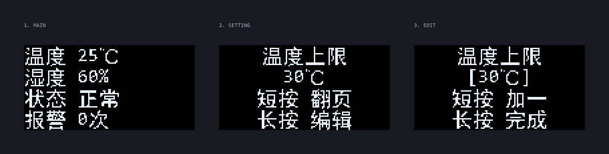

# 01 · 基于 STM32 的智能温湿度监测系统

> **难度** ★　|　**主控** STM32F103C8T6　|　**状态** 🚧 代码已完成，待上机验证

实时采集环境温湿度并在 OLED 上显示，温湿度超过设定范围时蜂鸣器报警、界面闪烁提示；
用一路触摸模块完成翻页、修改上下限等全部操作，不需要额外的按键和屏幕菜单。



> 图为按固件同款字库渲染的 128×64 界面示意（`firmware/tools/gen_font.py --preview` 生成）。

## 功能

- 每 2 秒采集一次温度、湿度（DHT11）
- OLED 实时显示，共 5 个页面：主界面 / 温度上限 / 温度下限 / 湿度上限 / 湿度下限
- 上下限可现场调节，超限立即报警：
  - 蜂鸣器间歇鸣叫（响 200ms、停 800ms）
  - 状态文字闪烁显示「超限」
  - 报警次数自动累计
- 传感器掉线（超过 6 秒没有有效数据）时显示「异常 / 检查接线」，不会误报警
- 串口（USART1，115200）输出采集值、报警事件和错误码，方便排查

## 硬件清单

| 模块 | 数量 | 说明 |
| :-- | :-- | :-- |
| STM32F103C8T6 最小系统板 | 1 | 蓝色核心板，8MHz 晶振 |
| DHT11 温湿度模块 | 1 | 单总线，模块自带 10k 上拉 |
| 0.96" OLED（SSD1306，I2C） | 1 | 4 针：VCC/GND/SCL/SDA |
| 触摸模块（TTP223） | 1 | 单键操作 |
| 有源蜂鸣器模块 | 1 | 高电平触发（默认）；低电平模块改一个宏即可 |
| ST-Link 下载器 | 1 | 烧录 + 调试 |
| USB-TTL（可选） | 1 | 看串口日志 |

## 接线

| 模块 | 模块引脚 | 接到 STM32 | 说明 |
| :-- | :-- | :-- | :-- |
| DHT11 | VCC | 3.3V | 模块支持 3.3~5V，接 3.3V 即可 |
| DHT11 | DATA | **PA1** | 单总线；裸传感器需要外接 4.7k~10k 上拉到 3.3V |
| DHT11 | GND | GND | |
| OLED | VCC | 3.3V | 不要接 5V |
| OLED | GND | GND | |
| OLED | SCL | **PB10**（或 PB6） | I2C2_SCL；接 PB6 也行，固件自动识别总线 |
| OLED | SDA | **PB11**（或 PB7） | I2C2_SDA；同上 |
| 触摸模块 | VCC | 3.3V | TTP223 |
| 触摸模块 | OUT | **PA2** | 高电平有效 |
| 触摸模块 | GND | GND | |
| 蜂鸣器 | VCC | 3.3V | 有源蜂鸣器（给电就响，不需要 PWM） |
| 蜂鸣器 | IN | **PB5** | 高电平触发（默认，低电平模块改宏） |
| 蜂鸣器 | GND | GND | |
| ST-Link | SWDIO | PA13 | 下载调试 |
| ST-Link | SWCLK | PA14 | |
| ST-Link | 3.3V / GND | 3.3V / GND | 给板子供电 |
| USB-TTL | RX | PA9 | 可选，接串口看日志 |
| USB-TTL | TX | PA10 | |
| USB-TTL | GND | GND | 必须共地 |

注意事项：

- OLED 接 **I2C2（PB10/PB11）** 或 **I2C1（PB6/PB7）** 都可以，固件上电会自动在两条总线上探测，
  串口会打印 `[OLED] ok, I2C2 addr=0x3C` 这样的信息。推荐用 PB10/PB11，
  把 I2C1 留给后面的 MPU6050、MAX30102 等传感器。
- 所有模块和核心板**必须共地**，否则 I2C 和单总线都会不稳定。
- 蜂鸣器模块分「高电平触发」和「低电平触发」两种，本项目默认**高电平触发**。
  如果一上电就一直响，说明模块是低电平触发（或 IN 接到了 3V3），
  把 `Core/Inc/board.h` 里的 `BUZZER_ON_LEVEL` 改成 `GPIO_PIN_RESET` 重新编译即可。
- 触摸模块的极性（TTP223 有高有效、低有效两种）**由固件上电自动识别**：
  上电后 200ms 内按空闲电平判断，所以**上电瞬间不要碰触摸板**。
- 屏幕右上角有个 8×8 的小方块，**触摸被识别时会点亮**，用来快速确认 PA2 有没有收到信号。

## 操作说明

只有一个触摸按键，用「短按 / 长按」组合出全部操作：

| 操作 | 在主界面 | 在设置页（未编辑） | 在设置页（编辑中） |
| :-- | :-- | :-- | :-- |
| 短按（< 0.8s） | 进入温度上限页 | 翻到下一页 | 数值 +1（湿度 +5） |
| 长按（≥ 0.8s） | 无动作 | 进入编辑 | 退出编辑 |

- 页面顺序：主界面 → 温度上限 → 温度下限 → 湿度上限 → 湿度下限 → 主界面
- 温度步进 1℃，范围 0~45℃；湿度步进 5%，范围 10~95%
- 上限不会低于下限、下限不会高于上限，调到边界会自动回到另一端
- 默认阈值：温度 10~30℃，湿度 30~80%

## 软件设计

```
main.c ──> app_init()
            ├─ 触摸引脚初始化（PA2 下拉输入）
            ├─ dht11_init()      开漏 + 上拉，使能 DWT 计数器
            └─ oled_init()       SSD1306 初始化、清屏

while(1) ─> app_task()
            ├─ button_poll()     20ms 消抖，区分短按/长按
            ├─ sensor_poll()     每 2s 读一次 DHT11
            ├─ alarm_manage()    阈值比较 + 报警计数 + 蜂鸣器节拍
            └─ ui_task()         200ms 刷屏（有变化时立即刷）
```

几个实现要点：

- **DHT11 时序**：起始信号拉低 20ms 用 `HAL_Delay`（不关中断），
  读 40 bit 时才关中断（约 3~5ms），尽量减少对串口和系统节拍的影响；
  微秒延时用 Cortex-M3 的 DWT 周期计数器，比 `for` 空循环准确。
- **引脚复用**：DHT11 用「开漏输出 + 内部上拉」，写 1 等于释放总线，
  读 `IDR` 就是总线实际电平，全程不用切换输入/输出方向。
- **OLED 显存**：1KB 显存按页组织，每页首字节固定 `0x40`（数据控制字），
  刷屏时整页一次发出，省一次内存拷贝。
- **中文字库**：只取代码里用到的 31 个汉字（16×16 点阵），
  改提示语后运行 `firmware/tools/gen_font.py` 重新生成，不占多余 Flash。
- **CubeMX 兼容**：所有自己的代码都在 `USER CODE BEGIN/END` 之间，
  以后在 CubeMX 里改配置重新生成代码不会被覆盖。

## 编译与烧录

环境搭建（CubeIDE 2.1.1 + CubeMX）见 [环境搭建文档](../docs/环境搭建-STM32CubeIDE.md)。

1. 打开 STM32CubeIDE：`File > Open Projects from File System...`
2. 目录选择本项目的 `firmware` 文件夹，Finish
3. `Ctrl+B` 编译（当前占用：Flash 约 23KB / 64KB，RAM 约 3.2KB / 20KB）
4. 接好 ST-Link，点 ▶ 烧录
5. 可选：PA9/PA10 接 USB-TTL，115200 打开串口助手看日志

## 上电自检：先看灯和声音

固件带自检，屏幕不亮时不用猜，先看板载 LED 和蜂鸣器：

| 阶段 | 现象 | 说明 |
| :-- | :-- | :-- |
| 上电瞬间 | 板载 LED 快闪 3 次 | 程序跑起来了（与屏幕、传感器无关） |
| 初始化完成后 | 蜂鸣器 **1 声** | 屏幕已识别 |
| 初始化完成后 | 蜂鸣器 **2 声** | 程序正常，但**没找到 OLED** |
| 正常运行 | 板载 LED 每秒亮灭各 0.5s | 主循环心跳 |
| 初始化失败 | 板载 LED 约 5Hz 快闪 | 时钟/外设初始化失败（最常见：HSE 晶振不起振） |

对照排查：

| LED 表现 | 结论 | 下一步 |
| :-- | :-- | :-- |
| 完全不亮 | 没供电 / 没下载成功 / BOOT0=1 | 看板上电源灯；重新下载；BOOT0 跳线接 0 |
| 闪 3 次后只剩心跳，屏幕黑，蜂鸣器 2 声 | 程序正常，OLED 没通信 | 量模块 VCC 是否有 3.3V、GND 是否共地、SCL/SDA 是否接反 |
| 闪 3 次 + 蜂鸣器 1 声，屏幕仍黑 | 屏幕应答了但没显示 | 模块可能是 SH1106（1.3 寸）或需要更高对比度 |
| 约 5Hz 连续快闪 | 初始化失败（多数是晶振） | 检查 8MHz 晶振，或改用 HSI 时钟 |
| 每秒亮灭 + 屏幕有字 | 正常 | — |

> 板载 LED 在 PC13，蓝色核心板是低电平点亮；极性相反的板子会表现为「常亮、每秒灭一下」，结论一样。

## 调试提示

| 现象 | 排查方向 |
| :-- | :-- |
| 屏幕全黑 | ① SCL/SDA 接到了 PB10/PB11 还是 PB6/PB7（两种都支持）；② 模块地址 0x3C/0x3D；③ 没共地、没供电 |
| 屏幕花屏/闪烁 | I2C 线太长或没有上拉，降到 100kHz 试试 |
| 温度显示 `--` | 串口看 `[DHT11] read failed, rc=-2/3/4`：-2 无应答（接线/上拉）、-3 超时、-4 校验错 |
| 蜂鸣器一直响 | 模块是**低电平**触发（默认按高电平写），改 `BUZZER_ON_LEVEL`；改完还响就检查 IN 是否接到了 3V3 |
| 触摸没反应 | 先看右上角小方块亮不亮：不亮＝PA2 没收到信号（查 OUT→PA2、VCC、GND）；亮但不翻页＝看串口 `[TOUCH]` 日志 |
| 数值一直是同一个 | DHT11 采样间隔被拉得太短，确认 2s 周期正常 |

## 扩展方向

- 阈值掉电保存（内部 Flash 最后一页 / W25QXX）
- 增加 ESP8266，把数据传到手机或 MQTT 服务器（见项目 15）
- 加一路按键做「确认/返回」，菜单交互会更顺手
- 换成 SHT30 等数字传感器，精度能到 0.1℃

## 进度

- [x] 硬件选型与接线方案
- [x] CubeMX 工程（时钟 72MHz、I2C1、USART1、GPIO）
- [x] DHT11 驱动（单总线时序 + 校验）
- [x] SSD1306 驱动（显存 + 中英文点阵）
- [x] 界面与单键交互逻辑
- [x] 编译通过（0 error / 0 warning）
- [ ] 上机联调（等待实物验证后更新为 ✅）
