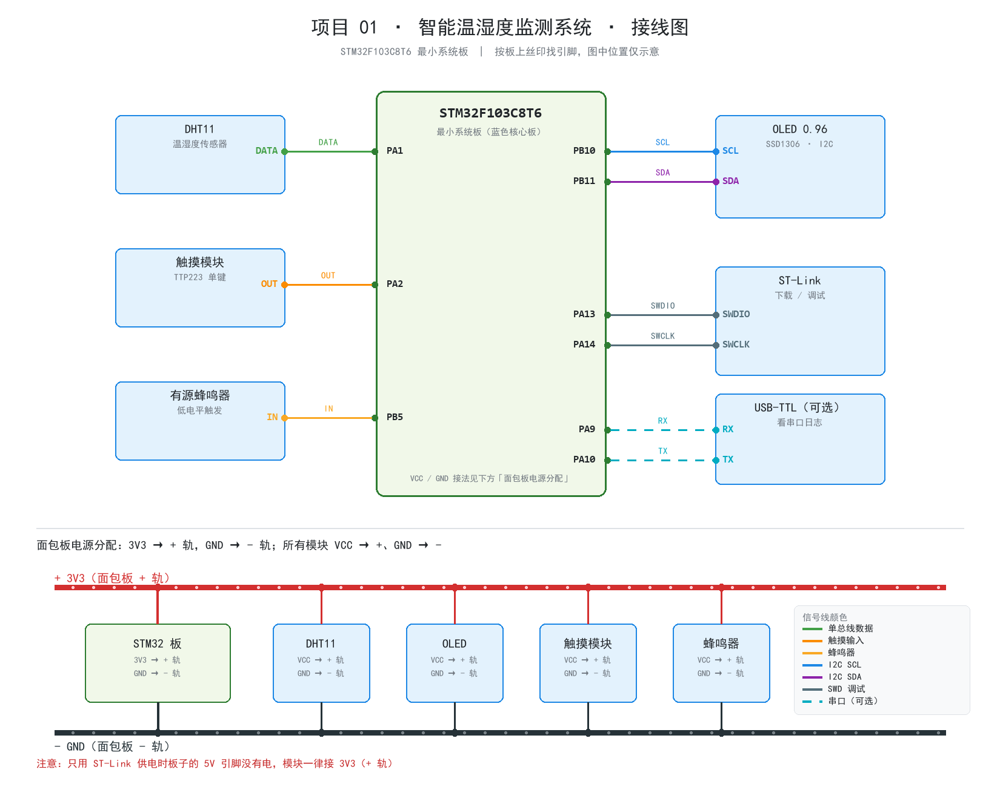

# 接线说明 · 项目 01 温湿度监测

> 主控：STM32F103C8T6 最小系统板（蓝色核心板）
> 涉及模块：DHT11、0.96" OLED（I2C）、触摸模块（TTP223）、有源蜂鸣器、ST-Link，可选 USB-TTL

> 图分两部分：**上半部分是信号线接法**，**下半部分是面包板电源分配**（3V3 → + 轨，GND → - 轨，
> 所有模块 VCC → + 轨、GND → - 轨）。
> 板子上的引脚位置按丝印找，图中左右位置只是示意，不代表实际排列顺序。

## 1. 供电方式（二选一）

| 方式 | 接法 | 说明 |
| :-- | :-- | :-- |
| ST-Link 供电（推荐） | ST-Link `3.3V` → 板子 `3V3`，`GND` → `GND` | 同时完成下载调试，一根线搞定 |
| USB 供电 | 板子 USB 口插线，ST-Link 只接 `SWDIO/SWCLK/GND` | USB 口供电时板子的 **5V 引脚才有电** |

> ⚠️ 只用 ST-Link 供电时，板子的 `5V` 引脚是**没有电压**的。OLED、蜂鸣器、触摸模块全部接 **3V3**，不要接 5V。

## 2. 电源与地（面包板电源轨）

面包板上下各有一对电源轨，**红/正极（+）轨**和**蓝/负极（-）轨**，整条轨上的孔都是相通的：

| 从 | 到 | 说明 |
| :-- | :-- | :-- |
| 板子 `3V3` | 面包板 **+ 轨** | 一根红线，整条轨就都是 3.3V |
| 板子 `GND` | 面包板 **- 轨** | 一根黑线，整条轨就都是地 |

然后所有模块**并联**在两条轨上：

| 模块 | VCC | GND |
| :-- | :-- | :-- |
| DHT11 | **+ 轨** | **- 轨** |
| OLED | **+ 轨** | **- 轨** |
| 触摸模块 | **+ 轨** | **- 轨** |
| 蜂鸣器 | **+ 轨** | **- 轨** |

> 口诀：**3V3 接 +，GND 接 -，模块 VCC 全接 +，模块 GND 全接 -**。
> 接线图的下半部分就是这个电源分配示意。

> 电流都不大（OLED ≈ 20mA、蜂鸣器 ≈ 30mA），ST-Link 的 3.3V 完全带得动。

## 3. 信号线（逐根）

| 序号 | 模块 | 模块引脚 | 接到板子 | 板子丝印 | 建议线色 | 说明 |
| :-: | :-- | :-- | :-- | :-- | :-- | :-- |
| 1 | DHT11 | DATA | PA1 | `PA1` | 绿 | 单总线；模块自带 10k 上拉 |
| 2 | 触摸模块 | OUT | PA2 | `PA2` | 橙 | 高/低有效由固件自检识别 |
| 3 | 蜂鸣器 | IN | PB5 | `PB5` | 黄 | 低电平触发（模块丝印） |
| 4 | OLED | SCL | PB10 | `PB10` | 蓝 | I2C2_SCL |
| 5 | OLED | SDA | PB11 | `PB11` | 紫 | I2C2_SDA |
| 6 | ST-Link | SWDIO | PA13 | `PA13` | 灰 | 下载调试 |
| 7 | ST-Link | SWCLK | PA14 | `PA14` | 灰 | 下载调试 |
| 8 | USB-TTL（可选） | RX | PA9 | `PA9` | 青 | 接 TTL 的 RX（交叉） |
| 9 | USB-TTL（可选） | TX | PA10 | `PA10` | 青 | 接 TTL 的 TX（交叉） |

要点：

- **OLED 也可以接 I2C1**：SCL→`PB6`、SDA→`PB7`。固件上电会自动在两条总线上找屏幕，
  串口会打印 `[OLED] ok, I2C2 addr=0x3C` 这样的信息。
  推荐还是接 PB10/PB11，把 I2C1 留给后面的 MPU6050、MAX30102 等传感器。
- **DHT11 如果是裸传感器**（4 个引脚、没有小板），DATA 与 3V3 之间要外接 **4.7k~10k 上拉电阻**；
  带小板的模块一般已经焊好上拉。
- **USB-TTL 是可选件**，只用来在电脑上看日志；串口参数 **115200 8N1**，记住 GND 也要接。

## 4. 建议接线顺序

按这个顺序接，每接一步都能验证，出错好定位：

1. **电源**：3V3 → + 轨（红），GND → - 轨（蓝/黑）
2. **OLED**：VCC → + 轨、GND → - 轨，SCL→PB10，SDA→PB11 → 上电，屏幕应点亮（此时还没烧程序，可能只是花屏/黑屏，属正常）
3. **DHT11**：VCC → + 轨、GND → - 轨，DATA→PA1
4. **蜂鸣器**：VCC → + 轨、GND → - 轨，IN→PB5
5. **触摸模块**：VCC → + 轨、GND → - 轨，OUT→PA2
6. **ST-Link**：SWDIO→PA13，SWCLK→PA14，3V3→3V3，GND→GND
7. **USB-TTL（可选）**：RX→PA9，TX→PA10，GND→GND

烧录后上电自检：LED 闪 3 下 → 蜂鸣器 1 声（屏幕 OK）或 2 声（屏幕没找到）→ 屏幕显示温湿度。

## 5. 上电前检查清单

- [ ] 所有模块 VCC 都在 **3V3**，没有一根接到 5V
- [ ] 所有 GND 都连到同一片地（共地）
- [ ] OLED 的 SCL/SDA **没有接反**（按模块丝印，不是按线的顺序）
- [ ] 蜂鸣器 IN 在 **PB5**，不是接到 3V3 或 GND
- [ ] 触摸 OUT 在 **PA2**
- [ ] 杜邦线插到底，面包板孔位没有松动（虚接是新手第一大坑）
- [ ] ST-Link 的 3V3 和 GND 都接了（只接 SWDIO/SWCLK 不能给板子供电）

## 6. 常见接线错误

| 现象 | 大概率原因 |
| :-- | :-- |
| 屏幕全黑，蜂鸣器 2 声 | OLED 的 VCC/GND 没接、SCL/SDA 接反、模块接在 5V |
| 屏幕亮但花屏 | SCL/SDA 接触不良、两根线太长，或 I2C 上拉不足 |
| 温度显示 `--` | DHT11 DATA 没接 PA1、模块没供电、裸传感器缺上拉电阻 |
| 蜂鸣器一直响 | IN 接到了 3V3/GND，或模块是高电平触发（改 `board.h` 的 `BUZZER_ON_LEVEL`） |
| 蜂鸣器完全不响 | IN 没接 PB5、VCC 没接、或模块是无源蜂鸣器（需要 PWM 才能响） |
| 触摸没反应 | OUT 没接 PA2；摸的时候看屏幕右上角小方块是否点亮 |
| 下载失败 / 找不到设备 | SWDIO/SWCLK 接反、没共地、SYS Debug 没选 Serial Wire |

## 7. 引脚占用一览

| 引脚 | 用途 | 备注 |
| :-- | :-- | :-- |
| PA1 | DHT11 DATA | 单总线 |
| PA2 | 触摸 OUT | 输入 |
| PB5 | 蜂鸣器 IN | 输出，低电平触发 |
| PB10 / PB11 | OLED SCL / SDA | I2C2（主用） |
| PB6 / PB7 | OLED 备选总线 | I2C1，留给后续传感器 |
| PA9 / PA10 | 调试串口 | USART1，115200 |
| PA13 / PA14 | SWD 调试 | ST-Link |
| PC13 | 板载 LED | 低电平点亮，心跳指示 |
| 3V3 / GND | 供电 | 所有模块共用 |
