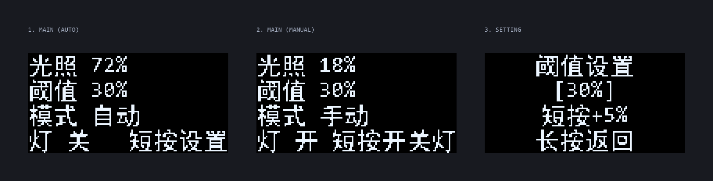
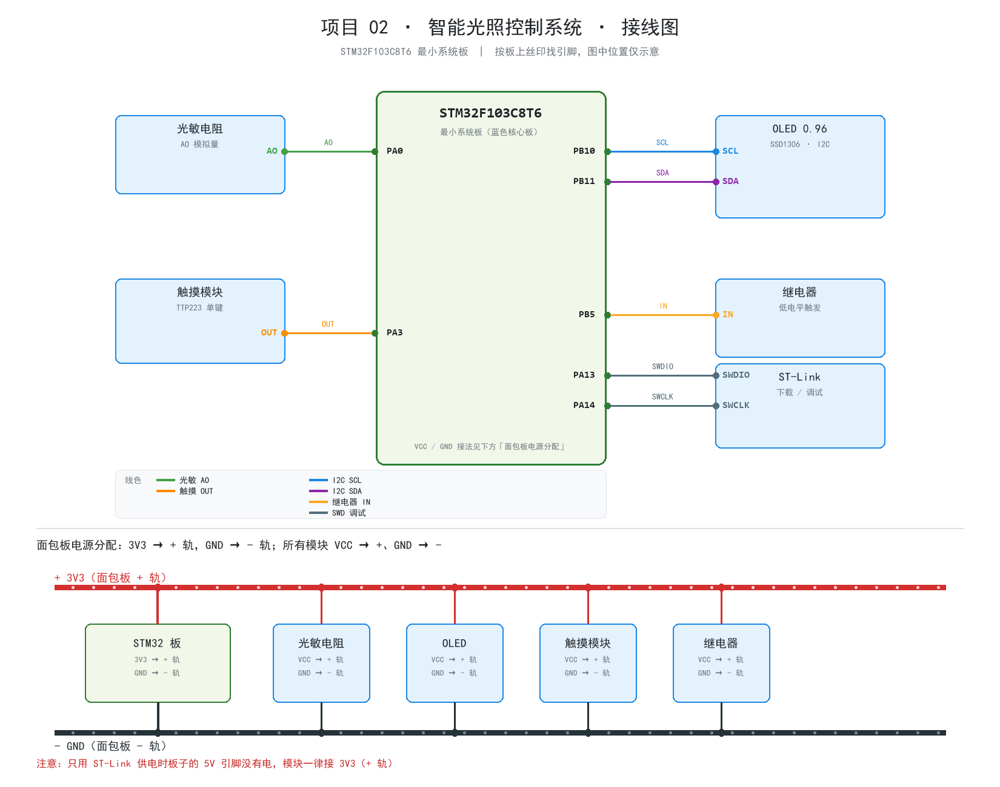

# 02 · 基于 STM32 的智能光照控制系统

> **难度** ★　|　**主控** STM32F103C8T6　|　**状态** 🚧 代码已完成，待上机验证

用光敏电阻采集环境亮度，低于阈值时自动点亮照明（继电器吸合）；
一个触摸键完成自动/手动切换、手动开关灯和阈值调节。



> 图为按固件同款字库渲染的 128×64 界面示意（`firmware/tools/gen_font.py --preview` 生成）。

## 功能

- ADC 采集光敏电阻，8 次平均滤波，换算成 0~100% 亮度
- **自动模式**：亮度 ≤ 阈值 → 开灯；亮度 ≥ 阈值 + 3% → 关灯（回差防抖，避免继电器反复吸合）
- **手动模式**：短按触摸键直接开关灯，不受光照影响
- 触摸键**长按**切换自动 / 手动；**自动模式下短按**进入阈值设置页
- 设置页：短按阈值 +5%（到 95% 回到 5%），长按返回主界面
- 主界面底部提示每 3 秒轮换，告诉你当前页面能做什么
- 串口（USART1，115200）输出模式、阈值、继电器动作日志

## 硬件清单

| 模块 | 数量 | 说明 |
| :-- | :-- | :-- |
| STM32F103C8T6 最小系统板 | 1 | 蓝色核心板，8MHz 晶振 |
| 光敏电阻模块 | 1 | 3/4 针，用 AO 模拟输出 |
| 0.96" OLED（SSD1306，I2C） | 1 | 4 针：VCC/GND/SCL/SDA |
| 触摸模块（TTP223） | 1 | 单键操作，复用项目 01 的模块 |
| 继电器模块 | 1 | 低电平触发（模块丝印），高电平改一个宏 |
| ST-Link 下载器 | 1 | 烧录 + 调试 |

> 原计划的旋转编码器（EC11）不是必需件：本项目用触摸键替代，硬件和项目 01 完全复用。
> 以后有了 EC11，可以把输入层换回编码器版本（代码在 git 历史里）。

## 接线



完整接线步骤、光敏方向判断、上电检查清单：**[hardware/接线说明.md](hardware/接线说明.md)**

| 模块 | 模块引脚 | 接到 STM32 | 说明 |
| :-- | :-- | :-- | :-- |
| 光敏电阻 | VCC / GND | 3.3V / GND | 不要接 5V |
| 光敏电阻 | AO | **PA0** | ADC1_IN0，模拟量 |
| OLED | VCC / GND | 3.3V / GND | |
| OLED | SCL / SDA | **PB10 / PB11** | I2C2；接 PB6/PB7 也能自动识别 |
| 触摸模块 | VCC / GND | 3.3V / GND | TTP223 |
| 触摸模块 | OUT | **PA3** | 高/低有效上电自动识别 |
| 继电器 | VCC / GND | 3.3V / GND | |
| 继电器 | IN | **PB5** | 低电平触发（模块丝印） |
| ST-Link | SWDIO / SWCLK | PA13 / PA14 | 另接 3.3V、GND |

> 面包板上：板子 `3V3` → **+ 轨**、`GND` → **- 轨**，所有模块 `VCC` → **+ 轨**、`GND` → **- 轨**。

## 操作说明

| 操作 | 主界面（自动） | 主界面（手动） | 阈值设置页 |
| :-- | :-- | :-- | :-- |
| 短按（< 0.8s） | 进入阈值设置 | 开灯 / 关灯 | 阈值 +5% |
| 长按（≥ 0.8s） | 切到手动 | 切到自动 | 返回主界面 |

- 阈值范围 5%~95%，默认 30%，步进 5%
- 切回自动模式时会立即按当前光照重新判断一次，不会停留在旧状态
- 上电后 200ms 内固件在识别触摸模块极性，这时**不要碰触摸板**

## 软件设计

```
main.c ──> app_init()
            ├─ LED / 继电器初始化（继电器默认断开）
            ├─ 触摸引脚初始化（PA3 下拉）+ 极性自检
            ├─ adc_init()       ADC1_IN0，239.5 周期采样，校准
            └─ oled_init()      I2C1/I2C2、0x3C/0x3D 自动探测

while(1) ─> app_task()
            ├─ button_poll()    20ms 消抖 + 短按/长按
            ├─ sensor_poll()    每 100ms 采 8 次 ADC 取平均
            ├─ apply_auto_control()  阈值 + 回差判断
            └─ ui_task()        200ms 刷屏
```

几个实现要点：

- **ADC**：`ADC1_IN0` 单次转换 + 软件平均；ADC 在 `adc.c` 里手工初始化
  （CubeMX 工程里只把 PA0 配成了模拟输入，ADC IP 没写进 `.ioc`）。
- **回差控制**：开灯用 `≤ 阈值`，关灯用 `≥ 阈值 + 3%`，中间区间保持状态，
  避免光照在阈值附近抖动时继电器「哒哒哒」反复吸合。
- **单键交互**：短按/长按按页面分工，界面上有轮换提示，不用背操作。
- **极性都能改**：光敏方向 `LIGHT_DARK_WHEN_LOW`、继电器 `RELAY_ON_LEVEL`，
  触摸极性由固件上电自动识别。

## 编译与烧录

环境搭建（CubeIDE 2.1.1 + CubeMX）见 [环境搭建文档](../docs/环境搭建-STM32CubeIDE.md)。

1. 打开 STM32CubeIDE：`File > Open Projects from File System...`
2. 目录选择本项目的 `firmware` 文件夹，Finish
3. `Ctrl+B` 编译（当前占用：Flash 约 26KB / 64KB，RAM 约 3.3KB / 20KB）
4. 接好 ST-Link，点 ▶ 烧录

## 调试提示

| 现象 | 排查方向 |
| :-- | :-- |
| 光照一直是 0% 或 100% | AO 没接 PA0、模块没供电；用万用表量 AO 电压应在 0~3.3V 变化 |
| 遮住光敏电阻数值反而变大 | 模块 AO 极性相反，把 `board.h` 的 `LIGHT_DARK_WHEN_LOW` 改成 0 |
| 继电器不动作 | IN 没接 PB5、模块没供电；量 PB5 在开灯时是否为低电平 |
| 继电器逻辑相反（该开时关） | 模块是高电平触发，把 `RELAY_ON_LEVEL` 改成 `GPIO_PIN_SET` |
| 触摸没反应 | OUT 没接 PA3、模块没供电；上电时别碰触摸板，否则极性会识别反 |
| 触摸一直“按下” | 极性识别反了，断电、手拿开再上电 |
| 屏幕黑屏 | 同项目 01：查 VCC/GND/SCL/SDA，固件会自动试 I2C1/I2C2 |

## ⚠️ 安全提醒

继电器模块是用来控制 220V 灯具的，**新手请先用 5V LED 或小灯泡做负载测试**，
确认逻辑正确后再考虑接市电；接市电时必须断电接线、做好绝缘，不要带电操作。

## 扩展方向

- 加人体红外（PIR），实现「有人且光线暗」才开灯
- 用 W25QXX 记录光照曲线，做一周用电分析
- 把继电器换成 MOS 管 / PWM，做 LED 灯带调光
- 买到 EC11 后换回编码器输入（阈值调节会更顺手）
- 加 ESP8266 上传光照数据（见项目 15）

## 进度

- [x] 硬件选型与接线方案（触摸键替代编码器）
- [x] CubeMX 工程（72MHz、I2C1/I2C2、USART1、GPIO）
- [x] ADC 采集与滤波
- [x] 单触摸键交互（短按/长按、极性自检）
- [x] 阈值 + 回差控制、自动/手动模式
- [x] 中文界面与界面预览
- [x] 编译通过（0 error / 0 warning）
- [ ] 上机联调
