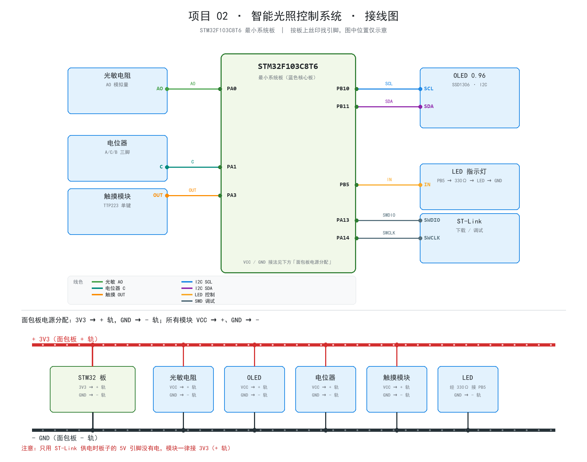

# 接线说明 · 项目 02 智能光照控制

> 主控：STM32F103C8T6 最小系统板（蓝色核心板）
> 涉及模块：光敏电阻模块、旋转电位器模块、0.96" OLED（I2C）、触摸模块（TTP223）、LED + 330Ω 电阻、ST-Link

> 图分两部分：**上半部分是信号线接法**，**下半部分是面包板电源分配**（3V3 → + 轨，GND → - 轨，
> 模块 VCC → + 轨、GND → - 轨）。
> 板子上的引脚位置按丝印找，图中左右位置只是示意，不代表实际排列顺序。

## 1. 供电方式（二选一）

| 方式 | 接法 | 说明 |
| :-- | :-- | :-- |
| ST-Link 供电（推荐） | ST-Link `3.3V` → 板子 `3V3`，`GND` → `GND` | 同时完成下载调试 |
| USB 供电 | 板子 USB 口插线，ST-Link 只接 `SWDIO/SWCLK/GND` | 板子的 5V 引脚这时才有电 |

> ⚠️ 只用 ST-Link 供电时，板子的 `5V` 引脚没有电压。模块全部接 **3V3**。

## 2. 电源与地（面包板电源轨）

| 从 | 到 | 说明 |
| :-- | :-- | :-- |
| 板子 `3V3` | 面包板 **+ 轨** | 一根红线，整条轨都是 3.3V |
| 板子 `GND` | 面包板 **- 轨** | 一根黑线，整条轨都是地 |

光敏、OLED、电位器、触摸都**并联**在两条轨上：`VCC → + 轨`、`GND → - 轨`。
LED 只需要 GND，不接 3V3。

> 口诀：**3V3 接 +，GND 接 -，模块 VCC 全接 +，模块 GND 全接 -**。

## 3. 信号线（逐根）

| 序号 | 模块 | 模块引脚 | 接到板子 | 板子丝印 | 建议线色 | 说明 |
| :-: | :-- | :-- | :-- | :-- | :-- | :-- |
| 1 | 光敏电阻 | AO | PA0 | `PA0` | 绿 | 模拟量，接 AO 不是 DO |
| 2 | 电位器 | C | PA1 | `PA1` | 青 | 中间抽头，旋钮调阈值 |
| 3 | OLED | SCL | PB10 | `PB10` | 蓝 | I2C2_SCL |
| 4 | OLED | SDA | PB11 | `PB11` | 紫 | I2C2_SDA |
| 5 | 触摸模块 | OUT | PA3 | `PA3` | 橙 | 高/低有效由固件上电自动识别 |
| 6 | LED | 正极（经 330Ω） | PB5 | `PB5` | 黄 | 电阻串在 PB5 和 LED 之间 |
| 7 | ST-Link | SWDIO | PA13 | `PA13` | 灰 | 下载调试 |
| 8 | ST-Link | SWCLK | PA14 | `PA14` | 灰 | 下载调试 |

### 3.1 光敏电阻模块

| 模块 | 引脚 | 接法 |
| :-- | :-- | :-- |
| 3 针版 | VCC / GND / AO | AO → PA0，VCC → + 轨，GND → - 轨 |
| 4 针版 | VCC / GND / DO / AO | 只接 AO，DO 空着（悬空即可） |

**方向判断**：上电后用手遮住光敏电阻，看屏幕上的「光照」百分比

- 遮住后变小 → 保持默认（`board.h` 里 `LIGHT_DARK_WHEN_LOW = 1`）
- 遮住后变大 → 把 `LIGHT_DARK_WHEN_LOW` 改成 `0`，重新编译

### 3.2 旋转电位器模块（阈值旋钮）

模块上一般印着 **A / C / B** 三个脚：

| 模块引脚 | 接到 | 说明 |
| :-- | :-- | :-- |
| A | + 轨（3V3） | 电阻的一端 |
| B | - 轨（GND） | 电阻的另一端 |
| C | PA1 | 中间抽头，输出电压 0~3.3V |

- 旋到最左/最右分别对应 5% / 95% 阈值。
- **方向反了**：把 A、B 两根线对调即可，不用改代码。
- 上电时先转到你想要的位置，固件启动时会读一次当前值作为初始阈值。

### 3.3 触摸模块（TTP223）

| 模块引脚 | 接到 | 说明 |
| :-- | :-- | :-- |
| VCC | + 轨 | 3.3V |
| GND | - 轨 | |
| OUT | PA3 | 触摸时输出电平（高/低由模块版本决定） |

- 固件上电后用 200ms 采样空闲电平，**自动判断高有效还是低有效**，
  所以上电瞬间**不要碰触摸板**（断电、手拿开再上电即可）。

### 3.4 LED 指示灯（代替继电器）

| LED 引脚 | 接到 | 说明 |
| :-- | :-- | :-- |
| 正极（长脚） | PB5 → **330Ω 电阻** → LED 正极 | 电阻任意一端接 PB5，另一端接 LED 正极 |
| 负极（短脚） | - 轨（GND） | |

- 电阻选 **330Ω ~ 1kΩ** 都行：330Ω 电流约 4mA，亮一些；1kΩ 约 1.3mA，暗一些但足够看。
- **LED 长脚是正极**，接反了不亮（但不会烧，反过来重插即可）。
- 固件默认 `ACTUATOR_MODE = ACTUATOR_LED`（高电平点亮）。

### 3.5 以后换继电器

买到单路继电器模块后：

1. `board.h` 把 `ACTUATOR_MODE` 改成 `ACTUATOR_RELAY`
2. PB5 接继电器 `IN`，继电器 `VCC/GND` 接 3V3/GND
3. 重新编译烧录，引脚不用动

## 4. 建议接线顺序

1. **电源**：3V3 → + 轨，GND → - 轨
2. **OLED**：VCC/GND → 电源轨，SCL→PB10，SDA→PB11
3. **光敏电阻**：VCC/GND → 电源轨，AO→PA0
4. **电位器**：A→+ 轨，B→- 轨，C→PA1
5. **触摸模块**：VCC/GND → 电源轨，OUT→PA3
6. **LED**：PB5 → 330Ω → LED 长脚，LED 短脚 → - 轨
7. **ST-Link**：SWDIO→PA13，SWCLK→PA14，3V3→3V3，GND→GND

烧录后上电：屏幕显示光照/阈值/模式/灯状态；用手遮住光敏电阻，LED 应点亮；
转动电位器，屏幕上的「阈值」应跟着变。

## 5. 上电前检查清单

- [ ] 模块 VCC 都在 **3V3**，没有接 5V 的
- [ ] 所有 GND 都连到同一片地
- [ ] 光敏电阻接的是 **AO**，不是 DO
- [ ] 电位器 A→3V3、B→GND、C→PA1（不是把 C 接电源）
- [ ] 触摸 OUT 接在 **PA3**
- [ ] LED 长脚朝 PB5 一侧、短脚接 GND，中间串了 330Ω 电阻
- [ ] ST-Link 的 3V3 和 GND 都接了

## 6. 常见接线错误

| 现象 | 大概率原因 |
| :-- | :-- |
| 光照一直是 0% 或 100% | AO 接到了 DO，或 AO 没插到 PA0 |
| 光照数值和明暗相反 | 模块 AO 极性相反，改 `LIGHT_DARK_WHEN_LOW` |
| 阈值不随旋钮变化 | C 没接 PA1、A/B 没接 3V3/GND，或模块没供电 |
| 旋钮方向相反 | A、B 两根线对调 |
| LED 不亮 | LED 接反（长脚是正）、电阻虚接、或 PB5 没输出 |
| LED 一直亮 | 光照低于阈值、或处于手动模式；看屏幕「模式 / 灯」 |
| 触摸没反应 | OUT 没接 PA3、模块没供电；看屏幕上「灯」有没有跟着变 |
| 屏幕黑屏 | VCC/GND/SCL/SDA；固件会自动试 I2C1/I2C2 和 0x3C/0x3D |

## 7. 引脚占用一览

| 引脚 | 用途 | 备注 |
| :-- | :-- | :-- |
| PA0 | 光敏电阻 AO | ADC1_IN0 |
| PA1 | 电位器 C | ADC1_IN1 |
| PA3 | 触摸模块 OUT | 输入（下拉），极性自检 |
| PB5 | LED（或继电器 IN） | 输出，LED 高电平点亮 / 继电器低电平触发 |
| PB10 / PB11 | OLED SCL / SDA | I2C2（主用） |
| PB6 / PB7 | OLED 备选总线 | I2C1，固件自动识别 |
| PA2 | 空闲 | 预留给旋转编码器（可选升级） |
| PA9 / PA10 | 调试串口（备用） | USART1，115200，本项目未接 |
| PA13 / PA14 | SWD 调试 | ST-Link |
| PC13 | 板载 LED | 低电平点亮，心跳指示 |
| 3V3 / GND | 供电 | 模块共用 |

## 8. 以后接继电器时的安全提醒

现在用 LED 做执行器，没有市电风险。等换成继电器控制 220V 灯具时：

- **先用 5V LED / 小灯泡测试逻辑**，确认无误后再考虑市电
- 接市电必须断电操作、做好绝缘，不要用手触摸继电器触点或裸露的 220V 端子
