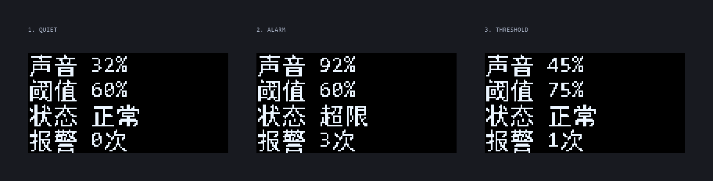
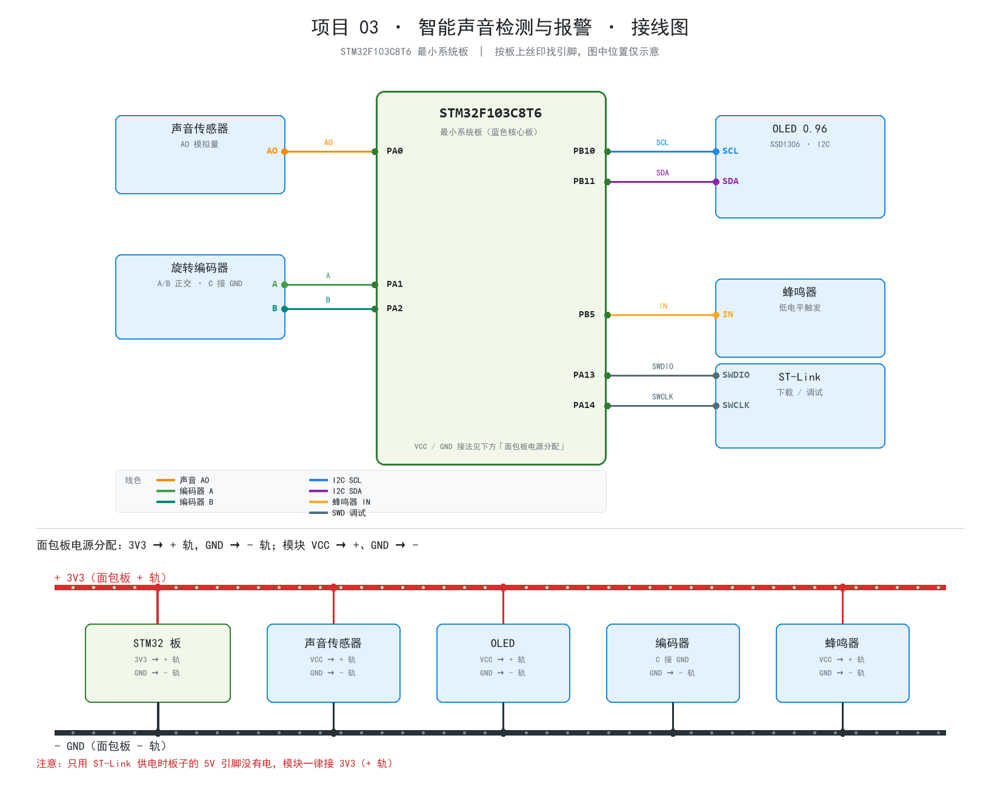

# 03 · 基于 STM32 的智能声音检测与报警系统

> **难度** ★　|　**主控** STM32F103C8T6　|　**状态** 🚧 代码已完成，待上机验证

用声音传感器实时检测环境噪音强度，超过设定阈值就蜂鸣器报警、屏幕状态闪烁；
阈值可以用旋转编码器现场调，报警次数自动累计。



> 图为按固件同款字库渲染的 128×64 界面示意（`firmware/tools/gen_font.py --preview` 生成）。

## 功能

- ADC 采集声音传感器，50Hz 采样，快起慢落的平滑处理，反应灵敏又不抖
- 显示当前声音强度（0~100%）和报警阈值
- **超过阈值 → 蜂鸣器间歇报警**（响 120ms、停 880ms），状态文字闪烁「超限」
- 声音回落到「阈值 - 3%」以下才解除报警（回差防抖）
- 每次触发报警，报警次数 +1，OLED 实时显示
- 旋转编码器调阈值：5%~95%，每格 5%
- 串口（USART1，115200）输出报警事件、阈值调整日志

## 硬件清单

| 模块 | 数量 | 说明 |
| :-- | :-- | :-- |
| STM32F103C8T6 最小系统板 | 1 | 蓝色核心板，8MHz 晶振 |
| 声音传感器模块 | 1 | 3 针：`OUT` / `VCC` / `GND`（4 针 AO/DO 版本也可以） |
| 旋转编码器（360°，A/C/B 三脚） | 1 | 复用项目 02 的模块 |
| 有源蜂鸣器模块 | 1 | 低电平触发（模块丝印） |
| 0.96" OLED（SSD1306，I2C） | 1 | 4 针：VCC/GND/SCL/SDA |
| ST-Link 下载器 | 1 | 烧录 + 调试 |

## 接线



完整接线步骤、上电检查清单：**[hardware/接线说明.md](hardware/接线说明.md)**

| 模块 | 模块引脚 | 接到 STM32 | 说明 |
| :-- | :-- | :-- | :-- |
| 声音传感器 | VCC / GND | 3.3V / GND | 3.3V 即可 |
| 声音传感器 | **OUT**（或 AO） | **PA0** | ADC1_IN0；4 针版本接 AO，不接 DO |
| 旋转编码器 | A | **PA1** | 内部上拉输入 |
| 旋转编码器 | B | **PA2** | 内部上拉输入 |
| 旋转编码器 | C（公共端） | **GND** | 三脚编码器的中间脚 |
| 蜂鸣器 | VCC / GND | 3.3V / GND | 有源蜂鸣器 |
| 蜂鸣器 | IN | **PB5** | 低电平触发（模块丝印） |
| OLED | VCC / GND | 3.3V / GND | |
| OLED | SCL / SDA | **PB10 / PB11** | I2C2；接 PB6/PB7 也能自动识别 |
| ST-Link | SWDIO / SWCLK | PA13 / PA14 | 另接 3.3V、GND |

> 面包板上：板子 `3V3` → **+ 轨**、`GND` → **- 轨**；模块 `VCC` → **+ 轨**、`GND` → **- 轨**。
> 编码器只接 GND，不接 3V3。

## 操作说明

| 操作 | 效果 |
| :-- | :-- |
| 旋转编码器 | 调报警阈值，每格 5%，5%~95% 循环 |
| 拍手 / 说话 / 放音乐 | 声音数值上升，超过阈值即报警 |
| 安静下来 | 数值回落到「阈值 - 3%」以下，报警自动解除 |

没有按键，上电就开始检测；阈值调好后不用管它。

## 软件设计

```
main.c ──> app_init()
            ├─ LED / 蜂鸣器初始化（蜂鸣器默认关闭）
            ├─ encoder_init()   PA1/PA2 上拉输入，正交解码
            ├─ adc_init()       ADC1 初始化、校准（PA0）
            └─ oled_init()      I2C1/I2C2、0x3C/0x3D 自动探测

while(1) ─> app_task()
            ├─ encoder_poll()   转一格阈值 ±5%
            ├─ sensor_poll()    每 20ms 采 4 次 ADC 取平均
            │                   └─ 快起慢落平滑 + 阈值/回差判断 + 计数
            ├─ 蜂鸣器节拍       报警时间歇鸣叫
            └─ ui_task()        150ms 刷屏，报警时状态闪烁
```

几个实现要点：

- **声音包络**：`level = (level + 3 × 新值) / 4`，新数据占 3/4，声音一响数值立刻上去，
  安静下来再慢慢回落，不会一闪一闪。
- **回差报警**：`≥ 阈值` 触发，`≤ 阈值 - 3%` 才解除，避免声音在阈值附近抖动时反复报警。
- **报警计数**：只在「正常 → 超限」的跳变时 +1，持续吵闹不会疯狂累加。
- **编码器解码**：A/B 状态表解码，`ENC_COUNTS_PER_STEP` 控制每格跳变数，方向反了改 `ENC_REVERSE`。

## 编译与烧录

环境搭建（CubeIDE 2.1.1 + CubeMX）见 [环境搭建文档](../docs/环境搭建-STM32CubeIDE.md)。

1. 打开 STM32CubeIDE：`File > Open Projects from File System...`
2. 目录选择本项目的 `firmware` 文件夹，Finish
3. `Ctrl+B` 编译（当前占用：Flash 约 25KB / 64KB，RAM 约 3.3KB / 20KB）
4. 接好 ST-Link，点 ▶ 烧录

## 调试提示

| 现象 | 排查方向 |
| :-- | :-- |
| 声音一直是 0% | OUT 没接 PA0、模块没供电；对着麦克风说话看数值是否变化 |
| 声音一直是 100% / 只在 0 和 100 之间跳 | 模块是**数字输出**，把 `board.h` 里 `SOUND_OUT_MODE` 改成 `0` |
| 声音一直是 100%（模拟版） | 模块电位器（蓝色旋钮）调得太灵敏，逆时针调低 |
| 一直报警不停 | 阈值设得太低，转编码器调高；或环境底噪大，模块灵敏度太高 |
| 拍手不报警 | 阈值太高，转编码器调低；或声音数值本身不变化（查 OUT） |
| 转编码器阈值不动 | A/B 没接 PA1/PA2、C 没接 GND |
| 转一格跳两下 | `ENC_COUNTS_PER_STEP` 改成 8 |
| 蜂鸣器一直响 | 模块是高电平触发，改 `BUZZER_ON_LEVEL`；或一直处于报警状态 |
| 蜂鸣器不响 | IN 没接 PB5、模块没供电、或模块触发极性与代码相反 |
| 屏幕黑屏 | 同项目 01：查 VCC/GND/SCL/SDA，固件会自动试 I2C1/I2C2 |

> 3 针模块（OUT/VCC/GND）的 OUT 可能是模拟量，也可能是高低电平。
> 上电后拍手：数值连续变化（比如 20%→80%）就是模拟输出，保持默认；
> 只在 0% 和 100% 之间跳就是数字输出，把 `SOUND_OUT_MODE` 改成 `0`。
> 数字版本的灵敏度由模块上的蓝色电位器决定。

## 扩展方向

- 用突发检测（短时间内数值跳变）区分「关门声 / 拍手 / 持续噪音」
- 用 W25QXX 记录每次报警的时间和强度
- 加 ESP8266，把报警推送到手机或 MQTT 服务器（见项目 12）
- 换成 I2S 数字麦克风，做简单的声音事件分类

## 进度

- [x] 硬件选型与接线方案（声音传感器 + 编码器 + 蜂鸣器 + OLED）
- [x] CubeMX 工程（72MHz、I2C1/I2C2、USART1、GPIO）
- [x] ADC 采集与快起慢落平滑
- [x] 阈值 + 回差报警、报警计数
- [x] 编码器调阈值
- [x] 中文界面与界面预览
- [x] 编译通过（0 error / 0 warning）
- [ ] 上机联调
