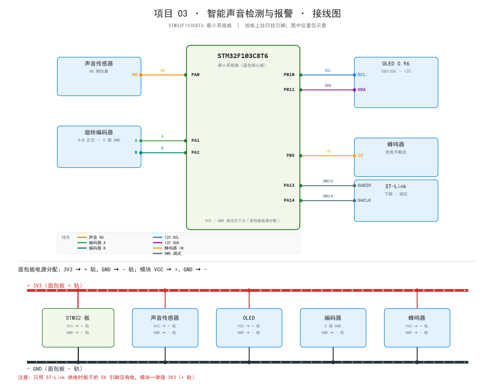

# 接线说明 · 项目 03 声音检测与报警

> 主控：STM32F103C8T6 最小系统板（蓝色核心板）
> 涉及模块：声音传感器（红色 LM393 模块）、旋转编码器（360°，A/C/B）、有源蜂鸣器、0.96" OLED（I2C）、ST-Link

> 图分两部分：**上半部分是信号线接法**，**下半部分是面包板电源分配**（3V3 → + 轨，GND → - 轨，
> 模块 VCC → + 轨、GND → - 轨）。
> 板子上的引脚位置按丝印找，图中左右位置只是示意，不代表实际排列顺序。

## 1. 供电方式（二选一）

| 方式 | 接法 | 说明 |
| :-- | :-- | :-- |
| ST-Link 供电（推荐） | ST-Link `3.3V` → 板子 `3V3`，`GND` → `GND` | 同时完成下载调试 |
| USB 供电 | 板子 USB 口插线，ST-Link 只接 `SWDIO/SWCLK/GND` | 板子的 5V 引脚这时才有电 |

> ⚠️ 只用 ST-Link 供电时，板子的 `5V` 引脚没有电压。模块全部接 **3V3**。

## 2. 电源与地（面包板电源轨）

| 从 | 到 | 说明 |
| :-- | :-- | :-- |
| 板子 `3V3` | 面包板 **+ 轨** | 一根红线，整条轨都是 3.3V |
| 板子 `GND` | 面包板 **- 轨** | 一根黑线，整条轨都是地 |

声音传感器、OLED、蜂鸣器并联在两条轨上：`VCC → + 轨`、`GND → - 轨`。
编码器只接 **- 轨**（公共端 C），不需要 3V3。

## 3. 信号线（逐根）

| 序号 | 模块 | 模块引脚 | 接到板子 | 板子丝印 | 建议线色 | 说明 |
| :-: | :-- | :-- | :-- | :-- | :-- | :-- |
| 1 | 声音传感器 | AO | PA0 | `PA0` | 橙 | 模拟量，接 AO 不是 DO |
| 2 | 编码器 | A | PA1 | `PA1` | 绿 | 内部上拉输入 |
| 3 | 编码器 | B | PA2 | `PA2` | 青 | 内部上拉输入 |
| 4 | 编码器 | C（公共端） | GND | `- 轨` | 黑 | 三脚编码器的中间脚 |
| 5 | OLED | SCL | PB10 | `PB10` | 蓝 | I2C2_SCL |
| 6 | OLED | SDA | PB11 | `PB11` | 紫 | I2C2_SDA |
| 7 | 蜂鸣器 | IN | PB5 | `PB5` | 黄 | 低电平触发 |
| 8 | ST-Link | SWDIO | PA13 | `PA13` | 灰 | 下载调试 |
| 9 | ST-Link | SWCLK | PA14 | `PA14` | 灰 | 下载调试 |

### 3.1 声音传感器模块

红色 LM393 小板，4 个脚：

| 模块引脚 | 接到 | 说明 |
| :-- | :-- | :-- |
| VCC | + 轨 | 3.3V |
| GND | - 轨 | |
| **AO** | **PA0** | 模拟输出，声音越大电压越高 |
| DO | 不接 | 数字比较输出，本项目不用 |

- 板上**蓝色电位器**调的是比较器（DO）的灵敏度，也会影响 AO 的幅度；
  如果声音数值一直顶满或一直为零，把它拧到中间再试。
- 判断模块是否正常：对着麦克风说话，AO 对 GND 的电压应有明显跳动（万用表可以看到）。

### 3.2 旋转编码器（360°，A/C/B 三脚）

| 模块引脚 | 接到 | 说明 |
| :-- | :-- | :-- |
| A | PA1 | 正交相 A，内部上拉 |
| B | PA2 | 正交相 B，内部上拉 |
| C | GND（- 轨） | 公共端 |

- 三脚编码器没有 VCC，**不要给它接 3V3**。
- 转一格跳两下 → `ENC_COUNTS_PER_STEP` 改成 8；转好几格才动一下 → 改成 2。
- 方向反了：A、B 对调，或 `ENC_REVERSE` 改 1。

### 3.3 有源蜂鸣器

| 模块引脚 | 接到 | 说明 |
| :-- | :-- | :-- |
| VCC | + 轨 | 3.3V |
| GND | - 轨 | |
| IN | PB5 | 低电平触发；高电平模块改 `BUZZER_ON_LEVEL` |

## 4. 建议接线顺序

1. **电源**：3V3 → + 轨，GND → - 轨
2. **OLED**：VCC/GND → 电源轨，SCL→PB10，SDA→PB11
3. **声音传感器**：VCC/GND → 电源轨，AO→PA0
4. **编码器**：A→PA1，B→PA2，C→- 轨
5. **蜂鸣器**：VCC/GND → 电源轨，IN→PB5
6. **ST-Link**：SWDIO→PA13，SWCLK→PA14，3V3→3V3，GND→GND

烧录后上电：屏幕显示声音/阈值/状态/报警；对着麦克风拍手，声音数值上升，超过阈值蜂鸣器响、状态闪「超限」。

## 5. 上电前检查清单

- [ ] 模块 VCC 都在 **3V3**，没有接 5V 的
- [ ] 所有 GND 都连到同一片地
- [ ] 声音传感器接的是 **AO**，不是 DO
- [ ] 编码器 A→PA1、B→PA2、**C→GND**
- [ ] 蜂鸣器 IN 在 **PB5**
- [ ] ST-Link 的 3V3 和 GND 都接了

## 6. 常见接线错误

| 现象 | 大概率原因 |
| :-- | :-- |
| 声音一直是 0% | AO 接到了 DO，或 AO 没插到 PA0 |
| 声音一直 100% | 模块灵敏度电位器拧到头，逆时针调低 |
| 一直报警 | 阈值太低或环境底噪大，转编码器调高 |
| 转编码器阈值不动 | A/B 没接 PA1/PA2、C 没接 GND |
| 转一格跳两下 | `ENC_COUNTS_PER_STEP` 改 8 |
| 蜂鸣器一直响 | 模块高电平触发，改 `BUZZER_ON_LEVEL` |
| 蜂鸣器不响 | IN 没接 PB5、模块没供电、或极性配反 |
| 屏幕黑屏 | VCC/GND/SCL/SDA；固件会自动试 I2C1/I2C2 和 0x3C/0x3D |

## 7. 引脚占用一览

| 引脚 | 用途 | 备注 |
| :-- | :-- | :-- |
| PA0 | 声音传感器 AO | ADC1_IN0 |
| PA1 / PA2 | 编码器 A / B | 内部上拉输入 |
| PB5 | 蜂鸣器 IN | 输出，低电平触发 |
| PB10 / PB11 | OLED SCL / SDA | I2C2（主用） |
| PB6 / PB7 | OLED 备选总线 | I2C1，固件自动识别 |
| PA9 / PA10 | 调试串口（备用） | USART1，115200，本项目未接 |
| PA13 / PA14 | SWD 调试 | ST-Link |
| PC13 | 板载 LED | 低电平点亮，心跳指示 |
| 3V3 / GND | 供电 | 模块共用 |
