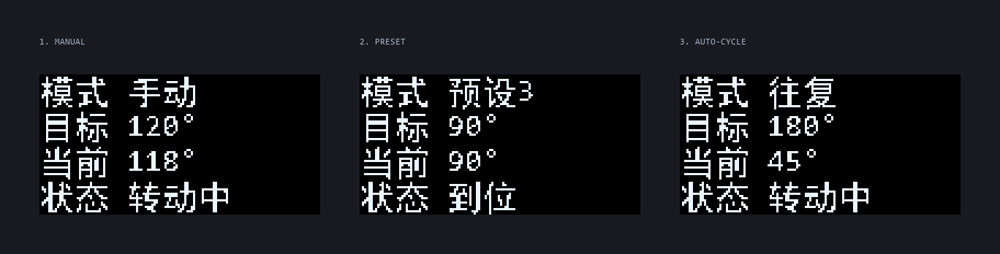
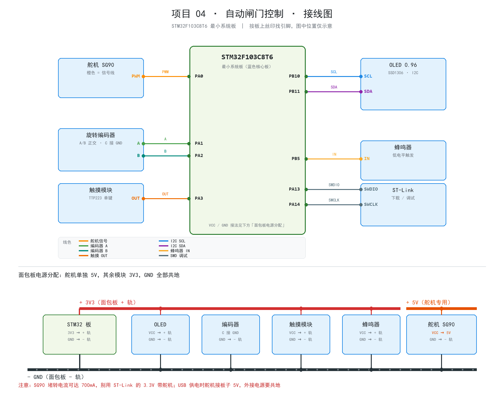

# 04 · 基于 STM32 的自动闸门控制系统

> **难度** ★　|　**主控** STM32F103C8T6　|　**状态** 🚧 代码已完成，待上机验证

用 SG90 带动一根纸板栏杆，做一个迷你道闸：编码器手动控制开度，触摸键切到预设开度或自动开合，
OLED 实时显示当前角度和运行状态。



> 图为按固件同款字库渲染的 128×64 界面示意（`firmware/tools/gen_font.py --preview` 生成）。

## 应用场景

停车场道闸、小区门禁、园区闸机，本质都是「一个能精确停在若干位置的水平转轴」：

| 闸门功能 | 固件里的模式 |
| :-- | :-- |
| 手动控制开度（点动开/关） | **手动**：编码器拧角度，0°~180° |
| 预设开度（关闸 / 半开 / 全开） | **预设**：5 个位置一键跳转 |
| 自动开合（车来即开、车走即关） | **往复**：0° ↔ 180° 循环 |

机械部分只需要：SG90 + 一根纸板/木条当栏杆 + 一个底座。

## 功能

- **50Hz PWM 驱动舵机**：0.5ms~2.5ms 对应 0°~180°，线性映射
- **缓动**：每 20ms 走 2°，180° 约 1.8 秒，栏杆是「抬起来」而不是「弹起来」
- **三种模式**（触摸短按循环切换）：
  - **手动**：编码器每格 ±5°，像按遥控器点动开闸/关闸
  - **预设**：5 个开度（0°/45°/90°/135°/180°），编码器切换，闸门自动转过去
  - **往复**：0° ↔ 180° 自动开合，模拟车辆连续通行
- **长按触摸**：一键关闸（回 0°），并切回手动模式
- **蜂鸣器提示**：到位「滴」60ms；手动拧到限位「滴」200ms
- 串口（USART1，115200）输出目标角度、模式切换日志

## 机械安装

1. 舵机固定在底座上，**舵盘朝上**
2. 纸板栏杆粘在舵盘上，装好后先让程序停在 0°（上电默认），此时栏杆应该是**水平关闭**状态
3. 转到 90° 时栏杆竖起 = 开闸
4. 如果方向相反（0° 反而竖直），把栏杆换个方向装，或者把 `SERVO_PULSE_MIN_US / MAX_US` 对调

> 舵机臂不要硬掰：上电前可以手动转舵盘对位，通电后靠 PWM 自动回位。

## 硬件清单

| 模块 | 数量 | 说明 |
| :-- | :-- | :-- |
| STM32F103C8T6 最小系统板 | 1 | 蓝色核心板，8MHz 晶振 |
| SG90 舵机 | 1 | 带动栏杆，橙色信号线接 PA0，红线 5V，棕线 GND |
| 旋转编码器（360°，A/C/B 三脚） | 1 | 复用项目 02 的模块 |
| 触摸模块（TTP223） | 1 | 复用项目 01/02 的模块 |
| 有源蜂鸣器模块 | 1 | 低电平触发 |
| 0.96" OLED（SSD1306，I2C） | 1 | 4 针：VCC/GND/SCL/SDA |
| ST-Link 下载器 | 1 | 烧录 + 调试 |

> ⚠️ **舵机要单独供电**：SG90 堵转电流可达 700mA，ST-Link 的 3.3V 带不动，
> 还可能把单片机拉复位。USB 供电时舵机接板子 `5V`，用外部电源时必须和板子**共地**。

## 接线



完整接线步骤、电源注意事项：**[hardware/接线说明.md](hardware/接线说明.md)**

| 模块 | 模块引脚 | 接到 STM32 | 说明 |
| :-- | :-- | :-- | :-- |
| 舵机 | 橙色（信号） | **PA0** | TIM2_CH1，50Hz PWM |
| 舵机 | 红色（VCC） | **5V** | 不要接 3.3V |
| 舵机 | 棕色（GND） | GND | 与板子共地 |
| 旋转编码器 | A | **PA1** | 内部上拉输入 |
| 旋转编码器 | B | **PA2** | 内部上拉输入 |
| 旋转编码器 | C（公共端） | **GND** | 三脚编码器的中间脚 |
| 触摸模块 | VCC / GND | 3.3V / GND | |
| 触摸模块 | OUT | **PA3** | 高/低有效上电自动识别 |
| 蜂鸣器 | VCC / GND | 3.3V / GND | 有源蜂鸣器 |
| 蜂鸣器 | IN | **PB5** | 低电平触发 |
| OLED | VCC / GND | 3.3V / GND | |
| OLED | SCL / SDA | **PB10 / PB11** | I2C2；接 PB6/PB7 也能自动识别 |
| ST-Link | SWDIO / SWCLK | PA13 / PA14 | 另接 3.3V、GND |

> 面包板上：板子 `3V3` → **+ 轨**（给 OLED / 触摸 / 蜂鸣器），`GND` → **- 轨**，
> 舵机 5V 单独走线，所有 GND 必须连在一起。

## 操作说明

| 操作 | 手动（点动） | 预设（开度） | 往复（自动开合） |
| :-- | :-- | :-- | :-- |
| 旋转编码器 | 开度 ±5°（0~180） | 切换 5 个开度 | 不参与 |
| 短按触摸 | → 预设 | → 往复 | → 手动 |
| 长按触摸 | 关闸回 0° | 关闸回 0° | 关闸回 0° |

- 屏幕第一行显示「手动 / 预设3 / 往复」，第四行显示「到位 / 转动中」
- 上电默认停在 0°（关闸），缓慢转到目标角度
- 上电后 200ms 内固件在识别触摸模块极性，这时**不要碰触摸板**

## 软件设计

```
main.c ──> app_init()
            ├─ LED / 蜂鸣器初始化
            ├─ 触摸引脚初始化（PA3 下拉）+ 极性自检
            ├─ encoder_init()   PA1/PA2 上拉输入，正交解码
            ├─ pwm_init()       TIM2_CH1：72 分频 → 1MHz，周期 20000 → 50Hz
            └─ oled_init()      I2C1/I2C2、0x3C/0x3D 自动探测

while(1) ─> app_task()
            ├─ button_poll()    20ms 消抖 + 短按/长按
            ├─ encoder_poll()   手动调开度 / 预设换挡
            ├─ ramp_task()      每 20ms 让当前角度向目标走 2°
            ├─ buzzer_task()    到位 / 限位提示音
            └─ ui_task()        150ms 刷屏
```

几个实现要点：

- **PWM 映射**：`CCR = 500 + angle × 2000 / 180`（单位 µs），0°→500、180°→2500。
- **TIM2 手工初始化**：`.ioc` 里 PA0 先配成普通输出，`pwm.c` 里改成复用推挽并配置 TIM2，
  这样 CubeMX 重新生成不会覆盖 PWM 参数（和项目 02/03 的 ADC 是同一套思路）。
- **缓动而不是直跳**：目标角度可以一步变 180°，但实际输出每 20ms 只走 2°，
  栏杆慢慢抬起，减速箱冲击小。
- **三态状态机**：`MODE_MANUAL / MODE_PRESET / MODE_SWEEP`，触摸短按轮转，长按强制关闸。

## 编译与烧录

环境搭建（CubeIDE 2.1.1 + CubeMX）见 [环境搭建文档](../docs/环境搭建-STM32CubeIDE.md)。

1. 打开 STM32CubeIDE：`File > Open Projects from File System...`
2. 目录选择本项目的 `firmware` 文件夹，Finish
3. `Ctrl+B` 编译（当前占用：Flash 约 25KB / 64KB，RAM 约 3.3KB / 20KB）
4. 接好 ST-Link，点 ▶ 烧录

## 调试提示

| 现象 | 排查方向 |
| :-- | :-- |
| 舵机不动 | 信号线没接 PA0、舵机没供电；量 PA0 是否有 50Hz 方波 |
| 舵机抖动/复位 | 供电不足：舵机接 5V 独立供电，和板子共地 |
| 开/关方向反了 | 栏杆换方向装，或把 `SERVO_PULSE_MIN_US/MAX_US` 对调 |
| 角度到不了 0/180 | 舵机个体差异，把 `SERVO_PULSE_MIN_US/MAX_US` 调到 600/2400 试 |
| 转编码器没反应 | A/B 没接 PA1/PA2、C 没接 GND |
| 转一格跳两下 | `ENC_COUNTS_PER_STEP` 改成 8 |
| 触摸没反应 | OUT 没接 PA3；上电时别碰触摸板 |
| 蜂鸣器一直响 | 模块高电平触发，改 `BUZZER_ON_LEVEL` |
| 屏幕黑屏 | 查 VCC/GND/SCL/SDA；固件会自动试 I2C1/I2C2 |

## 扩展方向

- 加红外对管/超声波（项目 05/21），做「车到自动开闸、车过自动关闸」
- 加限位开关做双重保护，避免堵转
- 加 ESP8266，手机远程开闸并记录通行日志（项目 15）
- 双舵机做成双向对开闸门

## 进度

- [x] 硬件选型与接线方案（舵机 + 编码器 + 触摸 + 蜂鸣器 + OLED）
- [x] CubeMX 工程（72MHz、I2C1/I2C2、USART1、GPIO）
- [x] TIM2 50Hz PWM 驱动与角度映射
- [x] 缓动、三态状态机（手动 / 预设 / 自动开合）
- [x] 触摸切模式、长按关闸
- [x] 中文界面与界面预览
- [x] 编译通过（0 error / 0 warning）
- [ ] 上机联调 / 栏杆机械结构
