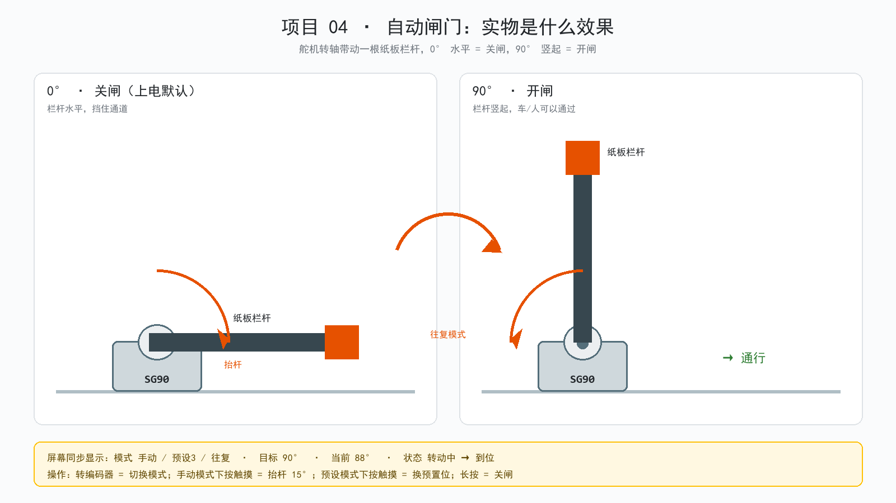

# 04 · 基于 STM32 的自动闸门控制系统

> **难度** ★　|　**主控** STM32F103C8T6　|　**状态** ✅ 已完成

用 SG90 带动纸板栏杆、红外避障检测车辆，做一个迷你道闸，三种工作模式：
**手动**（按触摸开/关）、**往复**（自动来回摆）、**自动**（红外检测到东西就开、离开就关）。
编码器转一格切换模式。


> 图为按固件同款字库渲染的 128×64 界面示意（`firmware/tools/gen_font.py --preview` 生成）。



> 舵机转轴带着栏杆转：0° 水平挡路（关闸），90° 竖起放行（开闸），180° 向后放平（往复端点）。

## 三种模式

| 模式 | 目标值 | 当前值怎么动 | 触发方式 |
| :-- | :-- | :-- | :-- |
| **手动** | 恒定 90° | 进入时回到 0°；按一次触摸 → 90°，再按 → 0° | 触摸模块 |
| **往复** | 跟随端点（0°/180°） | 自动在 0° ↔ 180° 之间来回 | 无需操作 |
| **自动** | 恒定 90° | 进入时回到 0°；红外检测到东西 → 90°，东西离开 → 0° | 红外避障 |

- 上电默认进入**手动**模式：目标 90°，当前 0°（栏杆水平关着）
- 任何模式下**长按触摸** = 强制关闸（当前值回 0°）
- 自动模式只响应红外**变化**：有东西经过升到 90°，离开回落 0°；停在原地不动不会反复触发

## 功能

- **50Hz PWM 驱动舵机**：0.5ms~2.5ms 对应 0°~180°，线性映射
- **缓动**：每 20ms 走 2°，90° 约 0.9 秒，栏杆是「抬起来」而不是「弹起来」
- **三种模式**（编码器转一格循环切换：手动 → 往复 → 自动）
- **红外消抖 50ms**：电平稳定才认，避免抖动导致栏杆乱动
- **蜂鸣器提示**：到位「滴」60ms；模式切换、红外变化也有提示音
- **OLED 四行状态**：模式 / 目标 / 当前 / 状态（到位、转动中、有车）
- 串口（USART1，115200）输出模式、红外事件、角度变化日志

## 机械安装

1. 舵机固定在底座上，**舵盘朝上**
2. 纸板栏杆粘在舵盘上，装好后让程序停在 0°（上电默认），此时栏杆应该是**水平关闭**状态
3. 转到 90° 时栏杆竖起 = 开闸；180° 向后放平 = 往复模式的另一个端点
4. 红外模块装在闸机前方 10~20cm，探头对着来车方向
5. 方向装反了：栏杆换个方向装，或把 `SERVO_PULSE_MIN_US / MAX_US` 对调

> 舵机臂不要硬掰：上电前可以手动转舵盘对位，通电后靠 PWM 自动回位。

## 硬件清单

| 模块 | 数量 | 说明 |
| :-- | :-- | :-- |
| STM32F103C8T6 最小系统板 | 1 | 蓝色核心板，8MHz 晶振 |
| SG90 舵机 | 1 | 带动栏杆，信号线接 PA0，红线 5V，棕线 GND |
| 红外避障模块 | 1 | 3 针 VCC/GND/OUT，OUT 接 PA4，检测到东西输出低电平 |
| 旋转编码器（360°，A/C/B 三脚） | 1 | 切模式，复用项目 02 的模块 |
| 触摸模块（TTP223） | 1 | 手动模式开/关闸，长按强制关闸 |
| 有源蜂鸣器模块 | 1 | 低电平触发 |
| 0.96" OLED（SSD1306，I2C） | 1 | 4 针：VCC/GND/SCL/SDA |
| ST-Link 下载器 | 1 | 烧录 + 调试 |

> ⚠️ **舵机要单独供电**：SG90 堵转电流可达 700mA，ST-Link 的 3.3V 带不动，
> 还可能把单片机拉复位。USB 供电时舵机接板子 `5V`，用外部电源时必须和板子**共地**。

## 接线


完整接线步骤、电源注意事项：**[hardware/接线说明.md](hardware/接线说明.md)**

| 模块 | 模块引脚 | 接到 STM32 | 说明 |
| :-- | :-- | :-- | :-- |
| 舵机 | 橙色（信号） | **PA0** | TIM2_CH1，50Hz PWM |
| 舵机 | 红色（VCC） | **5V** | 不要接 3.3V |
| 舵机 | 棕色（GND） | GND | 与板子共地 |
| 红外避障 | VCC / GND | 3.3V / GND | |
| 红外避障 | OUT | **PA4** | 检测到东西输出低电平 |
| 旋转编码器 | A / B / C | **PA1 / PA2 / GND** | C 是公共端 |
| 触摸模块 | VCC / GND | 3.3V / GND | |
| 触摸模块 | OUT | **PA3** | 高/低有效上电自动识别 |
| 蜂鸣器 | VCC / GND | 3.3V / GND | 有源蜂鸣器 |
| 蜂鸣器 | IN | **PB5** | 低电平触发 |
| OLED | VCC / GND | 3.3V / GND | |
| OLED | SCL / SDA | **PB10 / PB11** | I2C2；接 PB6/PB7 也能自动识别 |
| ST-Link | SWDIO / SWCLK | PA13 / PA14 | 另接 3.3V、GND |

> 面包板上：板子 `3V3` → **+ 轨**（给红外 / OLED / 触摸 / 蜂鸣器），`GND` → **- 轨**，
> 舵机 5V 单独走线，所有 GND 必须连在一起。

## 操作说明

| 操作 | 手动 | 往复 | 自动 |
| :-- | :-- | :-- | :-- |
| 转编码器 | 切到往复 | 切到自动 | 切到手动 |
| 短按触摸 | 开闸 → 关闸 切换 | 无动作 | 无动作 |
| 长按触摸 | 强制关闸 | 强制关闸 | 强制关闸 |
| 红外检测到东西 | 无动作 | 无动作 | 当前值 → 90° |
| 东西离开 | 无动作 | 无动作 | 当前值 → 0° |

- 屏幕四行：`模式` / `目标` / `当前` / `状态`
- 状态三种：`转动中`（正在走）、`到位`（已停稳）、`有车`（自动模式检测到东西）
- 每次切换模式，当前值都会先回到 0°（往复模式除外，它从当前角度继续摆）

## 软件设计

```
main.c ──> app_init()
            ├─ LED / 蜂鸣器初始化
            ├─ 触摸（PA3 下拉 + 极性自检）、红外（PA4 上拉）初始化
            ├─ encoder_init()   PA1/PA2 上拉输入，正交解码
            ├─ pwm_init()       TIM2_CH1：72 分频 → 1MHz，周期 20000 → 50Hz
            └─ oled_init()      I2C1/I2C2、0x3C/0x3D 自动探测

while(1) ─> app_task()
            ├─ ir_task()        50ms 消抖；自动模式下按变化开/关闸
            ├─ button_poll()    手动模式短按开关；长按任何模式强制关闸
            ├─ encoder_poll()   转一格循环切换 手动/往复/自动
            ├─ ramp_task()      每 20ms 让当前角度向目标走 2°；往复到头折返
            ├─ buzzer_task()    提示音节拍
            └─ ui_task()        150ms 刷屏
```

几个实现要点：

- **目标与当前分开**：`s_cmd` 是舵机要去的角度，`s_current` 是缓动后的实际输出；
  屏幕上的「目标」在手动/自动下固定 90°，往复下跟随折返端点。
- **红外只认变化**：上升沿（有东西）开闸，下降沿（离开）关闸；东西一直挡着不会反复触发。
- **消抖 50ms**：机械/环境抖动不会让栏杆乱动。
- **PWM 映射**：`CCR = 500 + angle × 2000 / 180`（µs），`pwm.c` 手工初始化 TIM2。
- **往复折返**：到位后把 `s_cmd` 切到另一个端点，缓动继续，不会「啪」地跳变。

## 编译与烧录

环境搭建（CubeIDE 2.1.1 + CubeMX）见 [环境搭建文档](../docs/环境搭建-STM32CubeIDE.md)。

1. 打开 STM32CubeIDE：`File > Open Projects from File System...`
2. 目录选择本项目的 `firmware` 文件夹，Finish
3. `Ctrl+B` 编译（当前占用：Flash 约 25KB / 64KB，RAM 约 3.3KB / 20KB）
4. 接好 ST-Link，点 ▶ 烧录

## 调试提示

| 现象 | 排查方向 |
| :-- | :-- |
| 舵机不动 | 信号线没接 PA0、舵机没供电；量 PA0 是否有 50Hz 方波 |
| 舵机抖动/复位 | 供电不足：舵机接 5V 独立供电，和板子共地 |
| 开/关方向反了 | 栏杆换方向装，或把 `SERVO_PULSE_MIN_US/MAX_US` 对调 |
| 手动模式按触摸没反应 | 确认屏幕「模式 手动」；自动/往复模式触摸不动作（长按除外） |
| 自动模式不动 | 确认「模式 自动」；用手挡一下红外探头，看屏幕「状态 有车」 |
| 红外一直「有车」 | OUT 极性相反（改 `IR_ACTIVE_LEVEL`）、电位器太灵敏、或接错脚 |
| 红外一直「无车」 | VCC/GND 没接、OUT 没接 PA4；挡住探头看模块指示灯 |
| 转编码器模式不变 | A/B 没接 PA1/PA2、C 没接 GND；转一格跳两下就改 `ENC_COUNTS_PER_STEP` |
| 蜂鸣器一直响 | 模块高电平触发，改 `BUZZER_ON_LEVEL` |
| 屏幕黑屏 | 查 VCC/GND/SCL/SDA；固件会自动试 I2C1/I2C2 |

## 视频简介

发布用文案（B 站 / 抖音 / 置顶评论）：**[docs/视频简介.md](docs/视频简介.md)**。

## 杂志风图文（5 页）

用 editorial-magazine 技能做的一组 1080×1440 编辑专题，讲清楚「三种模式怎么分工、红外怎么检测、栏杆怎么动」：

[封面](docs/magazine/page-01.png) · [论述](docs/magazine/page-02.png) · [一次通行](docs/magazine/page-03.png) · [手动与兜底](docs/magazine/page-04.png) · [参数附录](docs/magazine/page-05.png)

可编辑源文件：[magazine.html](docs/magazine/magazine.html)，素材与来源见 [sources.md](docs/magazine/sources.md)。

> 说明：这组图文按上一版「两模式」制作，正文里的「两模式」「3 秒延时」描述与现在的三模式固件不一致；需要的话可按三模式重出一版。

## 扩展方向

- 加超声波测距，做「车到 30cm 内才开闸」
- 加第二个红外判断车是否真的通过，避免人走过误开
- 加 ESP8266，手机远程开闸 + 通行日志（项目 15）
- 双舵机做双向对开闸门

## 进度

- [x] 硬件选型与接线方案（舵机 + 红外 + 编码器 + 触摸 + 蜂鸣器 + OLED）
- [x] CubeMX 工程（72MHz、I2C1/I2C2、USART1、GPIO）
- [x] TIM2 50Hz PWM 驱动与角度映射
- [x] 三种模式：手动 / 往复 / 自动（编码器切换）
- [x] 红外消抖与上升沿/下降沿开合闸
- [x] 触摸开关闸、长按强制关闸
- [x] 中文界面与界面预览
- [x] 编译通过（0 error / 0 warning）
- [x] 上机联调 / 栏杆机械结构
