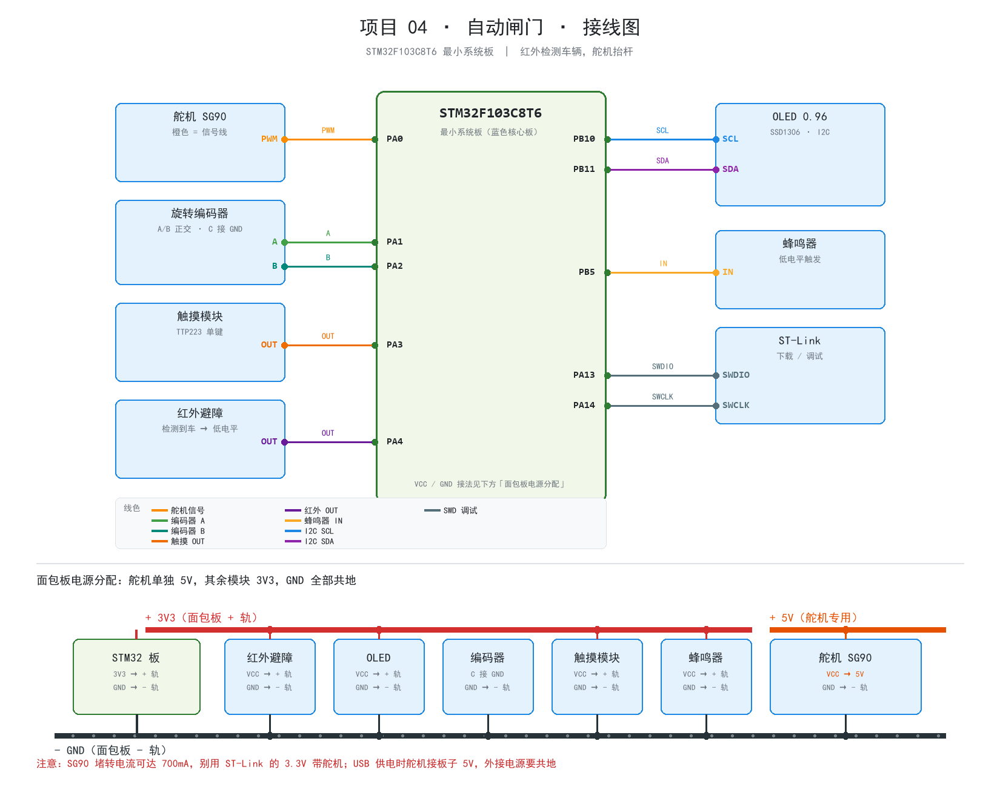

# 接线说明 · 项目 04 自动闸门控制

> 主控：STM32F103C8T6 最小系统板（蓝色核心板）
> 涉及模块：SG90 舵机（闸门转轴）、旋转编码器（360°，A/C/B）、触摸模块（TTP223）、有源蜂鸣器、0.96" OLED（I2C）、ST-Link

> 图分两部分：**上半部分是信号线接法**，**下半部分是电源分配**。
> 舵机单独吃 5V，其余模块用 3V3，所有 GND 必须共地。

## 1. 供电方式

| 方式 | 接法 | 说明 |
| :-- | :-- | :-- |
| USB 供电 + ST-Link 调试 | 板子 USB 口插线，舵机接板子 `5V`；ST-Link 只接 `SWDIO/SWCLK/GND` | 推荐，5V 引脚有电 |
| 外部 5V 电源 | 舵机 VCC 接外部 5V，外部电源 GND 与板子 GND 相连 | 舵机多、负载大时用 |

> ⚠️ **别用 ST-Link 的 3.3V 带舵机**：SG90 堵转电流可达 700mA，
> 轻则舵机没力、抖动，重则单片机复位。

## 2. 电源与地

| 从 | 到 | 说明 |
| :-- | :-- | :-- |
| 板子 `3V3` | 面包板 **+ 轨** | 给 OLED / 触摸 / 蜂鸣器 |
| 板子 `GND` | 面包板 **- 轨** | 所有模块和舵机的 GND 都接这里 |
| 板子 `5V` | 舵机红线 | 舵机单独走线，不经过 + 轨 |

## 3. 信号线（逐根）

| 序号 | 模块 | 模块引脚 | 接到板子 | 板子丝印 | 建议线色 | 说明 |
| :-: | :-- | :-- | :-- | :-- | :-- | :-- |
| 1 | 舵机 | 橙色（信号） | PA0 | `PA0` | 橙 | TIM2_CH1，50Hz PWM |
| 2 | 编码器 | A | PA1 | `PA1` | 绿 | 内部上拉输入 |
| 3 | 编码器 | B | PA2 | `PA2` | 青 | 内部上拉输入 |
| 4 | 编码器 | C（公共端） | GND | `- 轨` | 黑 | 三脚编码器的中间脚 |
| 5 | 触摸模块 | OUT | PA3 | `PA3` | 橙 | 高/低有效由固件自动识别 |
| 6 | OLED | SCL | PB10 | `PB10` | 蓝 | I2C2_SCL |
| 7 | OLED | SDA | PB11 | `PB11` | 紫 | I2C2_SDA |
| 8 | 蜂鸣器 | IN | PB5 | `PB5` | 黄 | 低电平触发 |
| 9 | ST-Link | SWDIO | PA13 | `PA13` | 灰 | 下载调试 |
| 10 | ST-Link | SWCLK | PA14 | `PA14` | 灰 | 下载调试 |

### 3.1 SG90 舵机

| 线色 | 接到 | 说明 |
| :-- | :-- | :-- |
| 橙（信号） | PA0 | PWM 信号，3.3V 电平舵机能识别 |
| 红（VCC） | 5V | 板子 5V 或外部 5V |
| 棕（GND） | GND | 必须和板子共地 |

- 上电固件先输出 0.5ms（0°），然后缓动到 90°；如果舵机一上电就乱甩，先查供电。
- 机械臂安装时，先让程序停在 90°，再把舵机臂装正。

### 3.2 旋转编码器（360°，A/C/B 三脚）

| 模块引脚 | 接到 | 说明 |
| :-- | :-- | :-- |
| A | PA1 | 正交相 A，内部上拉 |
| B | PA2 | 正交相 B，内部上拉 |
| C | GND（- 轨） | 公共端 |

- 三脚编码器没有 VCC，**不要接 3V3**。
- 转一格跳两下 → `ENC_COUNTS_PER_STEP` 改成 8；转好几格才动 → 改成 2。
- 方向反了：A、B 对调，或 `ENC_REVERSE` 改 1。

### 3.3 触摸模块（TTP223）

| 模块引脚 | 接到 | 说明 |
| :-- | :-- | :-- |
| VCC / GND | + 轨 / - 轨 | 3.3V |
| OUT | PA3 | 短按执行当前模式动作，长按关闸 |

固件上电用 200ms 采样空闲电平自动判断高有效/低有效，上电时别碰触摸板。

### 3.4 有源蜂鸣器

| 模块引脚 | 接到 | 说明 |
| :-- | :-- | :-- |
| VCC / GND | + 轨 / - 轨 | 3.3V |
| IN | PB5 | 低电平触发；高电平模块改 `BUZZER_ON_LEVEL` |

## 4. 建议接线顺序

1. **地线**：板子 GND → - 轨，舵机棕线 → - 轨
2. **舵机电源**：舵机红线 → 板子 5V（或外部 5V，共地）
3. **舵机信号**：橙线 → PA0
4. **编码器**：A→PA1，B→PA2，C→- 轨
5. **触摸**：VCC/GND → 电源轨，OUT→PA3
6. **蜂鸣器**：VCC/GND → 电源轨，IN→PB5
7. **OLED**：VCC/GND → 电源轨，SCL→PB10，SDA→PB11
8. **ST-Link**：SWDIO→PA13，SWCLK→PA14，3V3→3V3，GND→GND

烧录后上电：舵机缓动到 90°，屏幕显示「模式 手动 / 目标 90° / 当前 90° / 状态 到位」。

## 5. 上电前检查清单

- [ ] 舵机红线接的是 **5V**，不是 3.3V
- [ ] 舵机棕线和板子 GND 连在一起
- [ ] 舵机橙线接 **PA0**
- [ ] 编码器 A→PA1、B→PA2、**C→GND**
- [ ] 触摸 OUT 接 **PA3**
- [ ] 蜂鸣器 IN 接 **PB5**
- [ ] OLED SCL/SDA 接 PB10/PB11
- [ ] ST-Link 的 3V3 和 GND 都接了

## 6. 常见接线错误

| 现象 | 大概率原因 |
| :-- | :-- |
| 舵机完全不转 | 信号没接 PA0、舵机没供电、GND 没共地 |
| 舵机抖一下就不动 / 单片机复位 | 舵机从板子 3.3V 取电，供电不足 |
| 角度范围不对（只能转一半） | 脉宽范围不匹配，调 `SERVO_PULSE_MIN_US/MAX_US` |
| 编码器没反应 | A/B 没接 PA1/PA2，或 C 没接 GND |
| 触摸没反应 | OUT 没接 PA3，或上电时手碰到了触摸板 |
| 蜂鸣器一直响 | 模块是高电平触发，改 `BUZZER_ON_LEVEL` |
| 屏幕黑屏 | 查 VCC/GND/SCL/SDA；固件会自动试 I2C1/I2C2 和 0x3C/0x3D |

## 7. 引脚占用一览

| 引脚 | 用途 | 备注 |
| :-- | :-- | :-- |
| PA0 | 舵机 PWM | TIM2_CH1，50Hz |
| PA1 / PA2 | 编码器 A / B | 内部上拉输入 |
| PA3 | 触摸 OUT | 输入（下拉），极性自检 |
| PB5 | 蜂鸣器 IN | 输出，低电平触发 |
| PB10 / PB11 | OLED SCL / SDA | I2C2（主用） |
| PB6 / PB7 | OLED 备选总线 | I2C1，固件自动识别 |
| PA9 / PA10 | 调试串口（备用） | USART1，115200，本项目未接 |
| PA13 / PA14 | SWD 调试 | ST-Link |
| PC13 | 板载 LED | 低电平点亮，心跳指示 |
| 3V3 / 5V / GND | 供电 | 3V3 给模块，5V 给舵机 |
