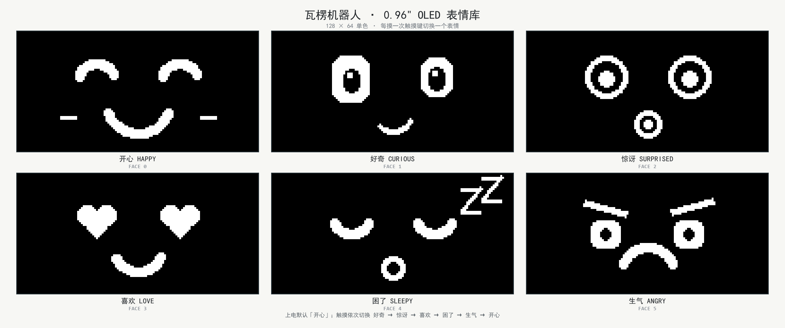
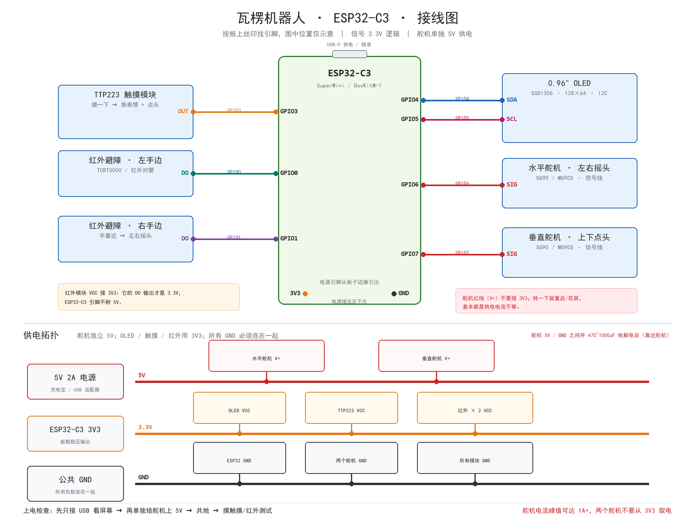

# 26 · 瓦楞机器人（ESP32-C3 纸板表情机器人）

> **难度** ★★　|　**主控** ESP32-C3　|　**状态** 🚧 代码与文档完成，逻辑测试通过，待上机验证

用两块瓦楞纸板、两个 SG90 舵机和一个 0.96" OLED，做一个会看人眼色的小脑袋：

- **摸一下触摸键** → 换一个表情，并上下点头；
- **手靠近左边 / 右边红外** → 朝那一侧开始，左右摇头；
- 没人理它时 → 偶尔眨眼，屏幕上的表情保持不动。

这不是三个功能各写一个 `delay()` 的拼接版。代码用**非阻塞状态机**把“表情、点头、摇头、眨眼”串起来：
舵机在动的时候，触摸仍然能立刻换表情，动作会排队补上，不会卡住。



> 上图为按固件同款坐标渲染的 128×64 界面示意，由 `firmware/tools/render_faces.py` 生成。

## 功能

| 操作 | 屏幕 | 动作 |
| :-- | :-- | :-- |
| 上电 | 开心（默认） | 两个舵机回中位 |
| 摸一下触摸键 | 切到下一个表情 | 抬头 → 低头 → 抬头 → 低头 → 回中 |
| 手靠近左红外 | 表情不变 | 先向左，左右摇 2 个来回，回中 |
| 手靠近右红外 | 表情不变 | 先向右，左右摇 2 个来回，回中 |
| 动作中再摸触摸 | **立即**切表情 | 当前动作结束后补一次点头 |
| 动作中再摸红外 | 表情不变 | 当前动作结束后补一次摇头（只保留最后一次） |

> 三个输入都是“按下沿”触发：手一直放在红外前只会摇一次，拿开再靠近才会再次触发。
> 这样不会因为手停在传感器前而无限循环。

六个表情依次为：

`开心 → 好奇 → 惊讶 → 喜欢 → 困了 → 生气 → 开心 …`

- 平时每隔 2.6~5.2 秒自动眨一次眼；切表情时也会先闭眼 130ms 再睁开。
- 串口 115200 输出触摸、红外、动作和 OLED 初始化日志，方便排查。
- OLED 自动尝试 `0x3C / 0x3D` 两个地址；屏幕装反了改一个宏即可旋转 180°。

## 硬件清单

| 模块 | 数量 | 说明 |
| :-- | :-: | :-- |
| ESP32-C3 开发板 | 1 | SuperMini / DevKitM-1 均可，Arduino-ESP32 3.x |
| SG90 或 MG90S 舵机 | 2 | 一个水平转头，一个上下点头；建议 MG90S 金属齿轮 |
| 0.96" OLED（SSD1306，I2C） | 1 | 128×64，4 针：VCC/GND/SCL/SDA |
| TTP223 触摸模块 | 1 | 单键，**瞬时模式**（不是自锁/翻转模式） |
| 红外避障模块 | 2 | TCRT5000 + LM393 比较器，带电位器，数字输出 |
| 5V 2A 电源 | 1 | 充电宝或 USB 适配器，**只给舵机供电** |
| 电解电容 470~1000µF | 1 | 跨接在舵机 5V / GND，抑制转头瞬间的电压跌落 |
| 瓦楞纸板、热熔胶、M2 螺丝 | 若干 | 做身体、头和屏幕支架 |
| 杜邦线 / 面包板 | 若干 | 信号和 3.3V 分配 |

> **不要用 ESP32-C3 的 3V3 给舵机供电。** SG90 堵转电流可以到 700mA 以上，
> 两个舵机同时动很容易把 3.3V 拉垮，表现为屏幕花屏、板子重启、舵机抖动。
> 舵机红线接独立 5V，所有 GND 连在一起。

## 接线



> 图中位置仅示意，实际以板子和模块上的丝印为准。

> 换引脚时避开 **GPIO2 / GPIO8 / GPIO9**（启动脚，GPIO9 还是 BOOT 键）和 **GPIO18 / GPIO19**（USB）。
> 本项目用的 GPIO0 / 1 / 3 / 4 / 5 / 6 / 7 在 ESP32-C3 SuperMini 上都能正常做数字 IO。

### 信号线

| 模块 | 模块引脚 | 接到 ESP32-C3 | 说明 |
| :-- | :-- | :-- | :-- |
| OLED | SDA | **GPIO4** | I2C 数据 |
| OLED | SCL | **GPIO5** | I2C 时钟 |
| 触摸模块 | OUT | **GPIO3** | TTP223 数字输出 |
| 左红外 | DO | **GPIO0** | 有遮挡时通常为低 |
| 右红外 | DO | **GPIO1** | 有遮挡时通常为低 |
| 水平舵机 | 信号（橙/黄） | **GPIO6** | 左右摇头 |
| 垂直舵机 | 信号（橙/黄） | **GPIO7** | 上下点头 |

### 电源线

| 模块 | VCC / V+ | GND |
| :-- | :-- | :-- |
| OLED | 3V3 | 公共 GND |
| 触摸模块 | 3V3 | 公共 GND |
| 左、右红外 | 3V3 | 公共 GND |
| 水平舵机 | **独立 5V** | 公共 GND |
| 垂直舵机 | **独立 5V** | 公共 GND |
| ESP32-C3 | USB-C 供电 | 公共 GND |

- 红外模块一定接 **3V3**：这样它的 DO 输出才是 3.3V。ESP32-C3 的 IO 不耐 5V。
- 5V 电源的负极、ESP32-C3 的 GND、所有模块的 GND 必须连在一起，否则信号没有共同参考点。
- 电容正极接 5V、负极接 GND，尽量靠近舵机；没有电容也能动，但更容易重启。
- 如果只有 USB 线、暂时没有独立 5V：先只接一个舵机做测试，并且不要让它带负载堵转；
  正式装头之前一定换成独立 5V。

### 上电顺序

1. 先只插 ESP32-C3 的 USB，确认屏幕亮、能看到表情；
2. 再接舵机 5V 电源，确认两个舵机回中位、没有嗡嗡堵转；
3. 摸触摸键和左右红外，看串口日志与动作；
4. 最后再把头装到舵机上，装好后重新检查中位和限位。

## 编译与烧录

### 1. 安装 Arduino-ESP32

Arduino IDE 2.x → 开发板管理器 → 搜索 `esp32` → 安装 **esp32 by Espressif Systems**（3.x）。

如果开发板管理器里没有 ESP32，在“附加开发板管理器网址”中加入：

```text
https://espressif.github.io/arduino-esp32/package_esp32_index.json
```

### 2. 安装库

库管理器里搜索并安装：

| 库 | 作者 | 用途 |
| :-- | :-- | :-- |
| **Adafruit SSD1306** | Adafruit | OLED 驱动 |
| **Adafruit GFX Library** | Adafruit | 画点、线、圆、圆角矩形 |
| **ESP32Servo** | Kevin Harrington | ESP32 舵机 PWM |

安装 `Adafruit SSD1306` 时如果提示安装依赖，选“Install all”。

### 3. 打开工程

打开：

```text
firmware/corrugated_robot/corrugated_robot.ino
```

开发板选择 **ESP32C3 Dev Module**，其他选项：

| 选项 | 建议值 |
| :-- | :-- |
| USB CDC On Boot | **Enabled**（这样 `Serial` 能直接从 USB 看日志） |
| CPU Frequency | 160MHz |
| Flash Size | 4MB |
| Partition Scheme | Default 4MB with spiffs |
| Upload Speed | 921600（不稳定就降到 460800） |

### 4. 烧录

点上传。如果一直停在 `Connecting...`：

1. 按住板上的 **BOOT** 键；
2. 点一下 **RST**；
3. 松开 BOOT，再点上传。

烧录完按 RST，串口应看到：

```text
=== 瓦楞机器人 / Corrugated Robot ===
[PIN] SDA=4 SCL=5 PAN=6 TILT=7 TOUCH=3 IR_L=0 IR_R=1
[OLED] ready, addr=0x3C
[SYS] ready, 摸屏幕中间的触摸键或左右红外
```

## 代码怎么实现

完整代码：[`firmware/corrugated_robot/corrugated_robot.ino`](firmware/corrugated_robot/corrugated_robot.ino)

### 1. 一个动作状态机，不用 delay

三个动作互斥，同一时间只有一个在跑：

```text
IDLE ──触摸──> NOD   （抬头→低头→抬头→低头→回中）
IDLE ──红外──> SHAKE （左→右→左→右→回中）

NOD / SHAKE 期间：
  触摸 → 立即换表情，pendingNod = true
  红外 → pendingShakeSide = 左/右
动作结束 → IDLE → 检查排队 → 启动下一个动作
```

舵机每 180~190ms 走一段，段与段之间不是 `delay()`，而是检查“上一段是否到位”。
这样主循环一直在跑，触摸和红外随时都能响应。

> 主循环末尾只有一句 `delay(1)`，是为了让出 1ms 给 ESP32 的系统任务；
> 舵机的等待仍然由 `millis()` 状态机完成，不是靠它“睡”完 180ms。

每段运动用 `smoothstep` 缓动，起停不会“啪”一下：

```cpp
void update() {
  if (durationMs == 0) return;

  uint32_t elapsed = millis() - startedAt;
  if (elapsed >= durationMs) {
    currentDeg = toDeg;
    durationMs = 0;
  } else {
    float t = (float)elapsed / (float)durationMs;
    t = t * t * (3.0f - 2.0f * t);          // 0→1 的平滑曲线
    currentDeg = fromDeg + (toDeg - fromDeg) * t;
  }
  servo.write((int)(currentDeg + 0.5f));
}
```

动作序列也是“一步接一步”推进的：

```cpp
if (motion == MOTION_NOD) {
  switch (motionStep) {
    case 1: tiltAxis.moveTo(tiltAngle(TILT_SWING), NOD_STEP_MS); break;
    case 2: tiltAxis.moveTo(tiltAngle(-TILT_SWING), NOD_STEP_MS); break;
    case 3: tiltAxis.moveTo(tiltAngle(TILT_SWING), NOD_STEP_MS); break;
    case 4: tiltAxis.moveTo(tiltAngle(0), NOD_STEP_MS); break;
    default: finishMotion(); break;
  }
}
```

水平摇头同理，只是把 `tiltAxis` 换成 `panAxis`，左右目标交替。
左红外触发时先往左，右红外触发时先往右，所以两个传感器虽然都触发“摇头”，
但第一下方向不同，能看出它朝哪边看。

### 2. 表情是画出来的，不是图片数组

0.96" OLED 只有 128×64 个像素，放六张全屏位图要占 6KB Flash，还要另外做取模。
这个项目直接用 Adafruit GFX 的基本图形拼脸：

- 圆角矩形 + 黑色瞳孔 + 白色高光 → 睁眼；
- 粗圆弧 → 笑眼、微笑、撇嘴；
- 两个圆 + 一个三角形 → 爱心眼；
- 圆环 + 实心圆 → 惊讶的嘴巴；
- 几条粗线 → 生气的眉毛和困意的 `Z`。

```cpp
void drawOpenEye(int cx, int cy, int w, int h) {
  display.fillRoundRect(cx - w / 2, cy - h / 2, w, h, 6, SSD1306_WHITE);
  display.fillRoundRect(cx - 4, cy - 5, 9, 13, 4, SSD1306_BLACK); // 瞳孔
  display.fillRect(cx - 2, cy - 3, 3, 3, SSD1306_WHITE);          // 高光
}
```

整张脸由 `drawFaceContent()` 里的 `switch (currentFace)` 决定。
改动眼睛/嘴巴坐标后，可以运行下面的脚本先看效果，不用反复烧板子：

```powershell
python firmware/tools/render_faces.py docs/ui-preview.png
```

### 3. 眨眼与切表情

- `eyesClosed` 为真时只画两条横线当眼皮，嘴巴保持原表情；
- 正常状态每 2.6~5.2 秒随机眨一次，每次 110ms；
- 摸触摸键时先把 `eyesClosed` 置真，130ms 后再睁开，看起来像屏幕“刷新”了一下；
- `困了` 表情不参与自动眨眼，因为它本来就是闭眼。

### 4. 输入消抖

每个输入都做 30ms 消抖，并且只在“从未按下变成按下”时触发一次：

```cpp
bool pressedEvent() {
  bool raw = readRaw();
  if (raw != lastRaw) {
    lastRaw = raw;
    changedAt = millis();
  }
  if ((millis() - changedAt) >= DEBOUNCE_MS && stable != raw) {
    stable = raw;
    return stable;       // 只返回按下沿，松开不触发
  }
  return false;
}
```

上电后 700ms 内不响应输入。TTP223 上电需要一点时间稳定，红外模块也可能因为桌面反光
先输出一个低电平；这段“预热”能避免一上电就自己点头。

模块极性由两个宏控制，不用改接线：

```cpp
constexpr bool TOUCH_ACTIVE_HIGH = true;   // TTP223 通常是高有效
constexpr bool IR_ACTIVE_LOW     = true;   // TCRT5000 通常是有遮挡为低
```

### 5. 内存与刷新

- SSD1306 的 1KB 显存由库在 RAM 中维护，ESP32-C3 完全够用；
- I2C 跑 400kHz，刷一整屏约 20~30ms；
- 只有“换表情 / 眨眼开始 / 眨眼结束”时才 `display.display()`，舵机运动期间不刷屏，
  避免 I2C 占用时间影响 PWM 节奏。

## 标定：装好后先改这几个数

所有参数都在 `.ino` 开头的“舵机标定”一节。

| 宏 | 默认 | 作用 |
| :-- | :-: | :-- |
| `PAN_CENTER` | 90 | 水平舵机机械中位 |
| `PAN_SWING` | 28 | 左右各摆 28° |
| `PAN_MIN_ANGLE` / `PAN_MAX_ANGLE` | 35 / 145 | 机械安全范围 |
| `PAN_DIR` | 1 | 左右方向反了改 `-1` |
| `TILT_CENTER` | 90 | 垂直舵机机械中位 |
| `TILT_SWING` | 20 | 上下各点 20° |
| `TILT_MIN_ANGLE` / `TILT_MAX_ANGLE` | 55 / 125 | 机械安全范围 |
| `TILT_DIR` | 1 | 点头方向反了改 `-1` |
| `NOD_STEP_MS` | 180 | 每点一下的时间，越大越慢 |
| `SHAKE_STEP_MS` | 190 | 每摇一下的时间，越大越慢 |
| `SERVO_MIN_US` / `SERVO_MAX_US` | 500 / 2400 | SG90 常用脉宽 |

标定步骤：

1. **先不装头**，上电看两个舵机是否回到 90°；
2. 装上舵盘时，让舵机处于 90°，再把头/支架摆正固定，这样中位不会偏；
3. 用手挡住左边红外，看第一下是不是向左。反了就把 `PAN_DIR` 改成 `-1`；
4. 摸触摸，看第一下是不是抬头。反了就把 `TILT_DIR` 改成 `-1`；
5. 如果头会撞到身体，先减小 `PAN_SWING` / `TILT_SWING`，再收窄安全角度；
6. 觉得动作太快像抽搐，把 `NOD_STEP_MS` / `SHAKE_STEP_MS` 加到 220~260。

> SG90 的 0° / 180° 不是所有批次都能到，机械上别顶着限位。
> 如果舵机在两端嗡鸣、发热，说明它被结构卡住了，立刻断电减小角度。

## 调试

| 现象 | 排查方向 |
| :-- | :-- |
| 屏幕全黑 | 查 VCC 是否 3V3、SDA/SCL 是否接反、地址是否 0x3D；串口看 `[OLED]` 日志 |
| 屏幕花屏 / 一动舵机就重启 | 舵机接了 3V3 或 USB 5V 电流不够；换独立 5V，加 470µF 电容，确认共地 |
| 触摸没反应 | OUT 是否接 GPIO3；模块是否为瞬时模式；试着把 `TOUCH_ACTIVE_HIGH` 改成 `false` |
| 触摸自己连续触发 | 模块灵敏度过高或电源干扰；给触摸板并 10~100nF 电容，或换一块 TTP223 |
| 红外一直触发 | 桌面/纸板反光；调模块上的电位器降低灵敏度，或把传感器略朝外 |
| 红外没反应 | DO 是否接 GPIO0/1；先接 3V3 再量 DO 电压，有手靠近时应翻转 |
| 只有一边红外有反应 | 左右模块的 DO 接反了，或其中一个模块坏；交换两个 DO 测试 |
| 舵机不动 | 信号线是否接 GPIO6/7；舵机 V+ 是否有 5V；共地是否接好 |
| 舵机抖 / 嗡鸣 | 供电不足、机械卡住、脉宽不匹配；先脱开负载测试，再把 `SERVO_MIN_US/MAX_US` 改成 1000/2000 |
| 左右方向反了 | `PAN_DIR` 改 `-1` |
| 点头方向反了 | `TILT_DIR` 改 `-1` |
| 串口没有输出 | 开发板选项里 `USB CDC On Boot` 设为 Enabled；换 USB 数据线 |
| 上传失败 | 按 BOOT + RST 进下载模式；降低上传波特率 |

### 串口日志示例

```text
[TOUCH] face -> CURIOUS
[MOTION] nod
[MOTION] done
[IR] left
[MOTION] shake, first=left
[MOTION] done
```

## 结构制作

推荐做成一个简单的 **二轴云台**：

```text
        ┌──────────────┐
        │  瓦楞纸头壳   │
        │  ┌────────┐  │
        │  │ OLED   │  │  ← 屏幕当脸
        │  └────────┘  │
        └──────┬───────┘
               │ 垂直舵机（点头）
        ┌──────┴───────┐
        │  水平舵机     │  ← 固定在身体顶部
        └──────┬───────┘
        ┌──────┴───────┐
        │   身体/底座   │
        └──────────────┘
```

- 水平舵机固定在身体上，舵盘朝上，连接一个 U 形纸板支架；
- 垂直舵机固定在 U 形支架侧面，舵盘连接头壳，头壳两侧做转轴；
- OLED 用热熔胶固定在头壳正面，屏幕窗口比可视区稍大 1~2mm；
- TTP223 可以贴在 1~2mm 纸板背面，纸板太厚会不灵敏；也可以在前面留一块触摸铜箔；
- 头壳重心尽量靠近水平舵机轴，否则舵机会一直用力，容易抖；
- 舵机线留一段余量，转头时不要拉紧；线从支架内侧走，避免卷进舵盘；
- 先用纸板做临时支架试角度，确认不撞、不卡，再上热熔胶固定。

尺寸不用复刻：0.96" OLED 模块大约 27×27mm，头壳做 80×70×50mm 左右就够；
身体做 100×80×70mm 左右，底部粘一块重一点的纸板/硬币配重，转头时更稳。

## 扩展方向

- 加一个无源蜂鸣器：换表情时“滴”一声，摇头时加一点机械音；
- 加 MPU6050：被拿起来/倾斜时做出“晕”的表情；
- 加光敏电阻：环境变暗时自动切到“困了”；
- 加 Wi-Fi：用 ESP32-C3 开一个小网页，远程换表情、调舵机角度；
- 把六个表情换成自己的画法：改 `drawFaceContent()` 即可，不用动动作逻辑；
- 用 ESP32-C3 的 LEDC 直接写 50Hz PWM，替代 ESP32Servo，进一步减小固件体积。

## 验证情况

- [x] C++ 语法检查与状态机逻辑测试通过（触摸换表情 + 点头、左右红外摇头、动作中排队、回中）
- [x] 依赖接口核对：Adafruit SSD1306 2.5.17 / Adafruit GFX 1.13.0 / ESP32Servo 3.2.1
- [x] 六个表情的 128×64 坐标预览
- [ ] ESP32-C3 实机编译与烧录
- [ ] 实物装配与长时间稳定性测试

## 进度

- [x] 硬件选型与接线方案
- [x] 六个表情的坐标设计与预览图
- [x] 非阻塞舵机动作状态机
- [x] 触摸 / 双红外消抖与动作排队
- [x] 眨眼、切表情闭眼动画
- [x] 串口日志与 OLED 地址自动探测
- [x] 本机语法检查与状态机逻辑测试
- [ ] ESP32-C3 实机编译、烧录
- [ ] 实物装配与长时间稳定性测试

> 这是对短视频里“瓦楞机器人”玩法的独立复刻实现，结构和外观可以按手头的纸板自由发挥。
